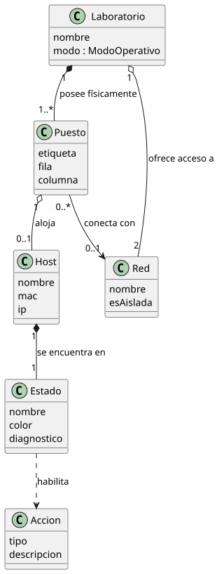
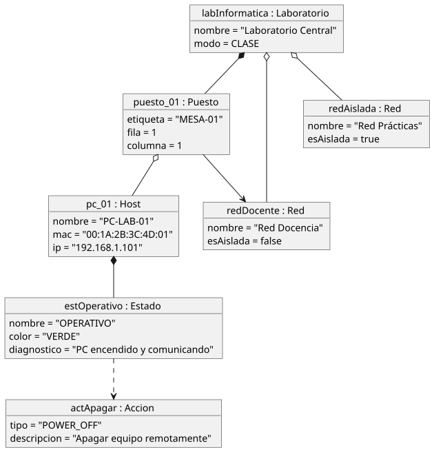
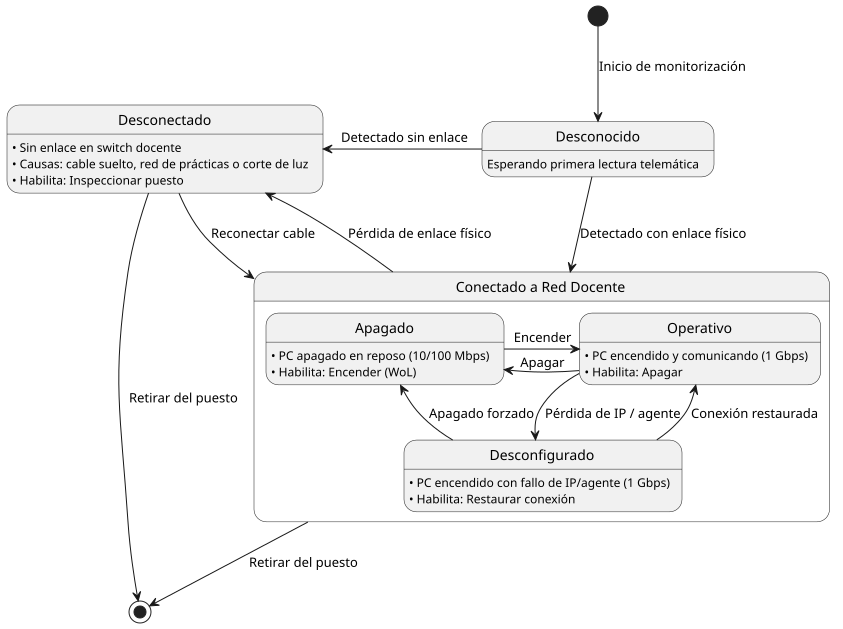
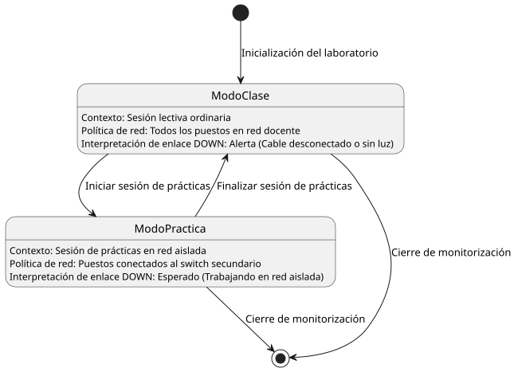

# OpSys - Modelo del dominio

## Información del artefacto
* **Proyecto:** OpSys - Plataforma de Supervisión y Configuración de un Laboratorio Docente Compartido 
* **Fase RUP:** Inicio (Inception)
* **Versión:** 1.0
* **Fecha:** 2026-10-12
* **Autor:** Equipo de desarrollo

---

## 1. Diagrama de Clases

Modela las entidades conceptuales del laboratorio docente, asegurando puestos físicos fijos, desacoplamiento de red en desconexión y navegación transitiva `Laboratorio -> Puesto -> Host`.

  
  
<em>Fuente: <a href="diagrama-clases.puml">diagrama-clases.puml</a></em>

---

## 2. Diagrama de Objetos

Instancia canónica 1:1 que valida el modelo con exactamente un objeto por clase, reflejando valores representativos de los atributos del sistema.

  
  
<em>Fuente: <a href="diagrama-objetos.puml">diagrama-objetos.puml</a></em>

---

## 3. Diagrama de Estados del Host

Modela el ciclo de vida telemático del equipo informático, estructurado bajo el superestado `Conectado a Red Docente` para evitar solapamiento de transiciones físicas y lógicas.

  
  
<em>Fuente: <a href="diagrama-estados/diagrama-estados-host.puml">diagrama-estados/diagrama-estados-host.puml</a></em>

---

## 4. Diagrama de Estados del Laboratorio

Modela la alternancia del contexto operativo del aula entre sesión ordinaria (`ModoClase`) y sesión de redes en switch secundario (`ModoPractica`).

  
  
<em>Fuente: <a href="diagrama-estados/diagrama-estados-laboratorio.puml">diagrama-estados/diagrama-estados-laboratorio.puml</a></em>

