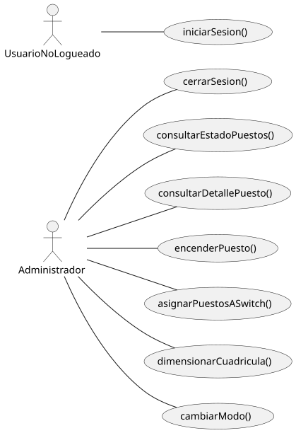
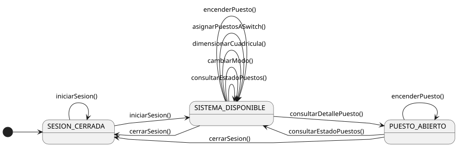

|      
|-:

# OpSys - Identificación de Actores y Casos de Uso

## Información del artefacto
* **Proyecto:** OpSys - Plataforma de Supervisión y Configuración de un Laboratorio Docente Compartido
* **Fase RUP:** Requisitos / Casos de Uso
* **Versión:** 1.0
* **Fecha:** 2026-11-16
* **Autor:** Equipo de desarrollo

---

## 1. Diagrama de Actores y Casos de Uso

Modela los casos de uso disponibles para el operador del laboratorio, estructurados conforme a los límites de sesión del sistema.

  
  
<em>Fuente: <a href="actoresCasosUsoAdmin.puml">actoresCasosUsoAdmin.puml</a></em>

---

## 2. Diagrama de Contexto

Modela los estados de navegación y contextos de interfaz del operador `Administrador`, reflejando la disponibilidad del sistema (`SESION_CERRADA`, `SISTEMA_DISPONIBLE` y `PUESTO_ABIERTO`) y los casos de uso que disparan cada transición o bucle operativo.

  
  
<em>Fuente: <a href="diagrama-de-contexto.puml">diagrama-de-contexto.puml</a></em>

---

## 3. Identificación y Descripción de Actores

Siguiendo el principio de operador único acordado en **[ADR-001](../../../docs/adr/ADR-001-acotamiento-acciones-trazabilidad.md)** y la delimitación estricta de la frontera del sistema (*System Boundary*), se modelan exclusivamente actores humanos que inician interacciones:

| Actor | Tipo | Descripción y Responsabilidad |
| :--- | :---: | :--- |
| **`UsuarioNoLogueado`** | Humano / Primario | Usuario anónimo que accede inicialmente a la interfaz web sin credenciales validadas. Su única interacción permitida es identificarse mediante el caso de uso `iniciarSesion()`. |
| **`Administrador`** | Humano / Primario | Operador responsable del aula (docente o técnico de laboratorio) una vez autenticado. Tiene control total para supervisar la telemetría en tiempo real, configurar la cuadrícula espacial, reasignar puestos a los switches, emitir encendido remoto por WoL, alternar el modo operativo y cerrar su sesión. |

### Justificación de Exclusión de Sistemas Externos como Actores
* **Servidor MeshCentral y Switch Docente:** No constituyen actores del modelo de casos de uso porque **no inician peticiones hacia el sistema** ni persiguen objetivos de usuario. Son **servicios externos de infraestructura** a los que el backend consulta activamente mediante adaptadores (SNMP v2c y CLI/API) durante la resolución interna de la telemetría.
* **Puestos Cliente (Workstations):** Actúan como receptores pasivos en Capa 2 (*Magic Packet* de difusión); carecen de interactividad o capacidad de iniciar flujos en el panel.

---

## 4. Catálogo Consolidado de Casos de Uso

El catálogo consta de **8 casos de uso** a nivel de objetivo de usuario (*User-Goal Level*), organizados según su ámbito funcional:

### 3.1. Gestión de Acceso y Sesión

#### `iniciarSesion()`
* **Actor Principal:** `UsuarioNoLogueado`.
* **Descripción:** El usuario introduce sus credenciales de acceso. Tras una autenticación exitosa, el sistema inicializa la sesión y transiciona al usuario al rol `Administrador`.
* **Precondición:** El usuario no se encuentra autenticado en el sistema.
* **Postcondición:** Se habilita el acceso completo al panel de control del laboratorio bajo el rol `Administrador`.

#### `cerrarSesion()`
* **Actor Principal:** `Administrador`.
* **Descripción:** El operador finaliza voluntariamente su sesión activa en el panel, invalidando el contexto autenticado.
* **Precondición:** Existe una sesión activa de `Administrador`.
* **Postcondición:** La sesión queda revocada y el actor regresa al estado `UsuarioNoLogueado`.

---

### 3.2. Observabilidad y Diagnóstico Telemático

#### `consultarEstadoPuestos()`
* **Actor Principal:** `Administrador`.
* **Descripción:** El sistema realiza la correlación determinista en memoria de Capa 1 (enlace físico en Switch Docente vía SNMP) y Capa 7 (presencia de agente en MeshCentral), retornando la cuadrícula con el estado semafórico en tiempo real de todos los puestos (`OPERATIVO`, `STANDBY`, `FALLO_LOGICO`, `RED_AISLADA`, `DESCONECTADO`), las métricas agregadas (KPIs) y el contexto operativo del aula.
* **Precondición:** El `Administrador` se encuentra autenticado.
* **Postcondición:** Se presenta visualmente la malla completa del aula con el estado actualizado de cada mesa de trabajo.

#### `consultarDetallePuesto()`
* **Actor Principal:** `Administrador`.
* **Descripción:** Permite inspeccionar en profundidad la ficha técnica y de cableado estructurado de un puesto específico al interactuar con su tarjeta en la cuadrícula (roseta física de pared `toma`, boca asignada en el switch, dirección MAC, IP lógica y desglose del diagnóstico determinista).
* **Precondición:** La cuadrícula de puestos se encuentra desplegada.
* **Postcondición:** Se visualizan los metadatos y el diagnóstico pormenorizado del puesto seleccionado.

---

### 3.3. Control Operativo y Energía

#### `encenderPuesto()`
* **Actor Principal:** `Administrador`.
* **Descripción:** Envía un paquete de difusión Ethernet de Capa 2 (*Magic Packet* / *Wake-on-LAN*) dirigido a la dirección MAC del puesto de trabajo en estado de reposo (`STANDBY`), activando la fuente de alimentación a través de la interfaz de red para preparar el equipo antes de la clase.
* **Precondición:** El puesto físico cuenta con un host asignado y se encuentra en estado `STANDBY` (chip PHY energizado en reposo $S5$).
* **Postcondición:** Se emite el paquete *Magic Packet* y el equipo inicia su secuencia de arranque.
* **Nota de Alcance ([ADR-002](../../../docs/adr/ADR-002-acotamiento-control-energia-hardware.md)):** Se excluye intencionadamente el apagado remoto interactivo debido a la ausencia física de procesador fuera de banda Intel AMT en las máquinas Dell OptiPlex (FPF fundidos de fábrica) y la inviabilidad por destino compartido (*fate sharing*) en puestos desconfigurados.

---

### 3.4. Configuración y Topología del Aula

#### `asignarPuestosASwitch()`
* **Actor Principal:** `Administrador`.
* **Descripción:** Permite asociar uno o múltiples puestos físicos (mediante selección directa o checkboxes en la interfaz) al **Switch Docente** (red universitaria ordinaria) o al **Switch de Prácticas** (red aislada para laboratorios de redes y sistemas). Permite configurar escenarios homogéneos o aulas híbridas con subgrupos simultáneos sin generar falsos positivos de desconexión.
* **Precondición:** Los puestos a reasignar existen en la cuadrícula activa y los conmutadores destino están definidos en el inventario.
* **Postcondición:** Se actualiza la asignación `puesto.switch_id` y el motor de evaluación recalcula de inmediato los diagnósticos semafóricos de los puestos afectados.

#### `dimensionarCuadricula()`
* **Actor Principal:** `Administrador`.
* **Descripción:** Permite ajustar en tiempo de ejecución las dimensiones espaciales de la cuadrícula del laboratorio especificando el número de filas ($F$) y columnas ($C$). El sistema calcula automáticamente la disposición física dividiendo las columnas en dos hileras simétricas separadas por un **pasillo central**.
* **Precondición:** El `Administrador` introduce valores válidos para filas ($F \ge 1$) y columnas ($C \ge 2$).
* **Postcondición:** La cuadrícula espacial se redimensiona y recalcula la distribución de puestos y pasillo central.

#### `cambiarModo()`
* **Actor Principal:** `Administrador`.
* **Descripción:** Conmuta la heurística contextual de interpretación de enlaces a nivel de todo el aula entre **`Modo Clase`** (un puerto `DOWN` indica anomalía física o cable desconectado $\rightarrow$ `DESCONECTADO`) y **`Modo Práctica`** (un puerto `DOWN` indica traslado legítimo del latiguillo al rack de prácticas $\rightarrow$ `RED_AISLADA`).
* **Precondición:** El laboratorio se encuentra activo.
* **Postcondición:** Se actualiza el atributo `laboratorio.modo` y se reevalúa en memoria en $< 1\text{ ms}$ el estado semafórico de todos los puestos conectados al switch docente.

---

## 5. Trazabilidad con Decisiones Arquitectónicas (ADRs)

* **[ADR-001: Justificación y Acotamiento de Acciones, Trazabilidad y Rol Administrador](../../../docs/adr/ADR-001-acotamiento-acciones-trazabilidad.md):** Fundamenta la existencia del `Administrador` como único operador humano en la frontera del sistema y descarta la reificación de acciones como clases del dominio en favor de casos de uso operativos.
* **[ADR-002: Acotamiento de Control de Energía (WoL vs Apagado)](../../../docs/adr/ADR-002-acotamiento-control-energia-hardware.md):** Fundamenta por qué `encenderPuesto()` es el único caso de uso de control energético viable y fiable bajo las restricciones de hardware del parque Dell OptiPlex (SKU 631-ADPL).
* **[ADR-004: Inclusión del Switch, Cuadrícula Dinámica y Aulas Híbridas](../../../docs/adr/ADR-004-inclusion-switch-asignacion-distribuciones.md):** Justifica la parametrización dinámica en `dimensionarCuadricula()` (filas, columnas y pasillo central) y la asignación granular de red mediante `asignarPuestosASwitch()`.
* **[Diagrama de Estados del Laboratorio (Modelo del Dominio)](../../00-modelo-del-dominio/README.md#4-diagrama-de-estados-del-laboratorio):** Modela el ciclo dinámico de alternancia gobernado por `cambiarModo()` (`EN_CLASE` $\leftrightarrow$ `EN_PRACTICA`).
