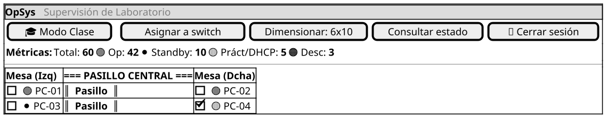

<div align=right>

|[](/README.md) [](/RUP/README.md) [](/RUP/00-modelo-del-dominio/README.md) [](/RUP/01-requisitos/README.md) [](/RUP/01-requisitos/01-detalle-casos-uso/README.md) [](/docs/matriz-documental-general.md) [](/docs/adr/README.md)
|-:

</div>

# Guía Estándar y Formato de Detallado de Casos de Uso (RUP)

Este documento define la metodología, reglas sintácticas, convenciones visuales y plantillas requeridas para la especificación formal, prototipado y documentación de cada caso de uso del sistema **OpSys** en la fase de **Requisitos**.

---

## 1. Estructura de Directorios y Política de Espejo

Cada caso de uso se aloja en su propio directorio dentro de `RUP/01-requisitos/01-detalle-casos-uso/<nombreCasoUso>/` y mantiene una correspondencia 1:1 estricta con la carpeta de imágenes vectoriales compiladas en `images/01-requisitos/01-detalle-casos-uso/<nombreCasoUso>/`:

```text
mesh-panel/
├── RUP/01-requisitos/01-detalle-casos-uso/
│   └── <nombreCasoUso>/
│       ├── especificacion.puml     # Autómata de interacción formal (Statechart)
│       ├── wireframes.puml         # Prototipo visual navegable (PlantUML Salt)
│       └── README.md               # Ficha descriptiva normalizada
└── images/01-requisitos/01-detalle-casos-uso/
    └── <nombreCasoUso>/
        ├── especificacion.svg      # SVG compilado del autómata
        └── wireframes.svg          # SVG compilado del prototipo
```

> [!IMPORTANT]
> **Regla de Formato SVG:** Todas las imágenes incrustadas en los documentos Markdown deben ser obligatoriamente gráficos vectoriales en formato `.svg`. Se prohíbe el uso de formatos rasterizados (`.png`, `.jpg`).

---

## 2. Especificación Formal de Interacción (`especificacion.puml`)

La especificación formal se modela como un diagrama de estados de interacción que captura el diálogo interactivo entre el **Actor** y el **Sistema**, partiendo y retornando a los contextos del [Diagrama de Contexto](../00-actores-casos-uso/README.md#2-diagrama-de-contexto) (`SESION_CERRADA`, `SISTEMA_DISPONIBLE`, `PUESTO_ABIERTO`).

### 2.1. Gramática Estricta de Verbos (Contrato de Interacción)
Para garantizar la separación entre la vista externa del usuario y el procesamiento interno del sistema, rige una gramática de verbos cerrada:

| Sujeto | Verbos Permitidos | Verbos Estrictamente Prohibidos |
| :--- | :--- | :--- |
| **Actor** | `solicita`, `introduce`, `solicita introducir` | `ejecuta`, `procesa`, `calcula`, `modifica` |
| **Sistema** | `presenta`, `muestra`, `visualiza`, `permite solicitar`, `permite introducir` | `obtiene`, `evalúa`, `calcula`, `procesa`, `consulta`, `conecta` |

> [!CAUTION]
> **Prohibición de Fuga de Procesamiento Interno:** Nunca modelar acciones internas del backend o daemon (como *"obtiene telemetría"* o *"evalúa diagnóstico determinista"*) en el diagrama de especificación de requisitos. El diagrama describe **únicamente** lo que el actor pide y lo que el sistema le presenta o le permite hacer.

### 2.2. Nodos de Decisión (`<<choice>>`)
Los flujos alternativos, validaciones o bifurcaciones condicionales deben modelarse mediante pseudestados de elección (`state c <<choice>>`):

```plantuml
state "SISTEMA_DISPONIBLE" as DISP
state c <<choice>>

DISP --> c : [Actor] solicita <accion>
c --> DISP : [condición_éxito] / [Sistema] presenta <resultado>
c --> DISP : [condición_error] / [Sistema] presenta mensaje de error
```

### 2.3. Plantilla Base: `especificacion.puml`

```plantuml
@startuml especificacion
title Especificación - <nombreCasoUso>()

skinparam monochrome true
skinparam shadowing false
skinparam defaultFontName sans-serif

[*] --> <CONTEXTO_ORIGEN>

state "<CONTEXTO_ORIGEN>" as ORIGEN
state c <<choice>>
state "<CONTEXTO_DESTINO>" as DESTINO

ORIGEN --> c : [Actor] solicita <accion>
note on link
  <b>Actor:</b> <NombreActor>
  <b>Acción:</b> <descripcion corta>
end note

c --> DESTINO : [<condición>] / [Sistema] presenta <resultado>
c --> ORIGEN : [error o cancelación] / [Sistema] presenta <mensaje>

@enduml
```

---

## 3. Prototipado de Interfaz de Usuario (`wireframes.puml`)

Los prototipos de interfaz se diseñan como maquetas visuales ejecutables mediante **PlantUML Salt** (`@startsalt`).

### 3.1. Convenciones Visuales y de Maquetación
1. **Alineación de Cabecera:**
   - La barra de navegación debe estructurarse en filas diferenciadas:
     - Fila 1: Título de la aplicación / vista (`{+ <b>OpSys</b> ...}`).
     - Fila 2: Botón de modo contextual a la izquierda (`[ 🎓 Modo Clase ]` o `[ 🧪 Modo Práctica ]`) inmediatamente bajo el título, y a la derecha los botones de acción global alineados horizontalmente sobre la misma línea base (`[ Asignar a switch ]`, `[Dimensionar: 6x10]`, `[Consultar estado]`, `[🚪 Cerrar sesión]`).
2. **Pasillo Central Explícito:**
   - Cuando se represente la cuadrícula de puestos del laboratorio, debe reflejarse obligatoriamente la división física de pasillo central:
     - Cabecera: `<b>=== PASILLO CENTRAL ===</b>`
     - Filas de datos: `<b>║  Pasillo  ║</b>`
3. **Sintaxis Estricta de Checkboxes en Salt:**
   - Usar `[] 🟢 PC-01` (desmarcado) y `[X] 🟢 PC-02` (marcado).
   - **Prohibido:** `[ ] [PC-01]` (Salt interpreta los corchetes como botones anidados, desfigurando el wireframe).
4. **Semáforo Determinista de Diagnóstico:**
   - 🟢 `OPERATIVO` (Encendido en red docente)
   - ⚫ `STANDBY` (Apagado / Reposo S5 con PHY energizado)
   - 🟡 `FALLO_LOGICO` (Enlace Gigabit sin conexión lógica) / `RED_AISLADA` (Modo Práctica)
   - 🟠 `DESCONECTADO` (Sin cable en roseta docente en Modo Clase)

### 3.2. Plantilla Base: `wireframes.puml`



---

## 4. Compilación Vectorial de Artefactos (SVG)

La compilación de los diagramas `.puml` a formato vectorial `.svg` se realiza mediante el compilador nativo de PlantUML, dirigiendo la salida a la carpeta espejo:

```bash
# Compilar especificación de estados
plantuml -tsvg -o "../../../images/01-requisitos/01-detalle-casos-uso/<nombreCasoUso>" \
  RUP/01-requisitos/01-detalle-casos-uso/<nombreCasoUso>/especificacion.puml

# Compilar wireframe Salt
plantuml -tsvg -o "../../../images/01-requisitos/01-detalle-casos-uso/<nombreCasoUso>" \
  RUP/01-requisitos/01-detalle-casos-uso/<nombreCasoUso>/wireframes.puml
```

> [!TIP]
> **Nombre del SVG de salida:** En la cabecera del archivo `.puml`, definir `@startuml especificacion` o `@startuml wireframes` para que el archivo compilado adopte directamente el nombre normalizado (`especificacion.svg` y `wireframes.svg`).

---

## 5. Plantilla de la Ficha Descriptiva (`README.md`)

Cada ficha descriptiva documenta el caso de uso siguiendo este esquema estandarizado:

```markdown
<div align=right>

|[](/README.md) [](/RUP/01-requisitos/README.md) [](/RUP/01-requisitos/00-actores-casos-uso/README.md#2-diagrama-de-contexto) [](/RUP/01-requisitos/01-detalle-casos-uso/README.md)
|-:

</div>

# OpSys > <nombreCasoUso>()

### Especificación

<div align="center">
  /especificacion.svg" alt="Especificación <nombreCasoUso>" />
  <p><em>Código fuente: <a href="especificacion.puml">especificacion.puml</a></em></p>
</div>

### Prototipo (Wireframe)

<div align="center">
  /wireframes.svg" alt="Wireframe <nombreCasoUso>" />
  <p><em>Código fuente: <a href="wireframes.puml">wireframes.puml</a></em></p>
</div>

## Información del caso de uso

| Atributo | Valor |
| :--- | :--- |
| **Actor** | <Administrador / UsuarioNoLogueado> |
| **Objetivo** | <Propósito de usuario en una sola frase concisa> |
| **Tipo** | <Primario / Secundario>, <esencial / soporte> |
| **Nivel** | Objetivo de usuario (User-Goal Level) |

### Descripción del caso de uso

<Descripción en prosa técnica y estructurada que desglose el diálogo interactivo, controles presentados y variaciones operacionales>.

### Referencias
* **Diagrama de contexto de Admin:** `<CONTEXTO_ORIGEN> --> <CONTEXTO_DESTINO> : <nombreCasoUso>()`
* **Modelo del dominio:** `<Entidades involucradas, ej: Laboratorio, Puesto, Host>`
* **Decisiones arquitectónicas:**
  * [ADR-001: Justificación y Acotamiento de Acciones, Trazabilidad y Rol Administrador](../../../../docs/adr/ADR-001-acotamiento-acciones-trazabilidad.md)
  * [ADR-00X: <Título de la decisión vinculada>](../../../../docs/adr/<archivo-ADR>.md)
```

---

## 6. Procedimiento Paso a Paso para Detallar un Nuevo Caso de Uso

Al abordar un nuevo caso de uso (`CU-XX`), seguir rigurosamente este protocolo:

1. **Crear carpetas de trabajo:**
   ```bash
   mkdir -p RUP/01-requisitos/01-detalle-casos-uso/<nombreCasoUso>
   mkdir -p images/01-requisitos/01-detalle-casos-uso/<nombreCasoUso>
   ```
2. **Elaborar `especificacion.puml`:** Modelar los estados respetando la gramática de verbos, nodos `<<choice>>` y la navegación del Diagrama de Contexto.
3. **Elaborar `wireframes.puml`:** Diseñar la maqueta en Salt aplicando alineación de botones, checkboxes `[]` y semáforos.
4. **Compilar a SVG:** Ejecutar `plantuml -tsvg` para generar `especificacion.svg` y `wireframes.svg` en la carpeta espejo de `images/`.
5. **Redactar `README.md`:** Completar la ficha descriptiva con navegación, tablas, descripciones y trazabilidad con ADRs.
6. **Actualizar el Cuadro de Mando:**
   - En `RUP/01-requisitos/01-detalle-casos-uso/README.md`, actualizar la fila correspondiente:
     - Cambiar estado a `🟢 Completado`.
     - Vincular la columna **Especificación** a `[Ficha](<nombreCasoUso>/README.md)`.
     - Vincular la columna **Wireframe / Prototipo** a `[wireframes.svg](../../../images/01-requisitos/01-detalle-casos-uso/<nombreCasoUso>/wireframes.svg)`.

---

## 7. Lista de Chequeo de Verificación (Definition of Done)

Antes de dar por cerrado un caso de uso detallado, verificar:

- [ ] ¿El autómata en `especificacion.puml` respeta la gramática de verbos (`solicita`/`introduce` vs `presenta`/`permite`) sin fugar procesos internos del backend?
- [ ] ¿Las transiciones concuerdan con el estado del Diagrama de Contexto (`SESION_CERRADA`, `SISTEMA_DISPONIBLE` o `PUESTO_ABIERTO`)?
- [ ] ¿Los wireframes en `wireframes.puml` utilizan la sintaxis limpia de checkbox (`[]` / `[X]`) y presentan la cabecera alineada?
- [ ] ¿Ambas imágenes vectoriales `.svg` existen y están compiladas en `images/01-requisitos/01-detalle-casos-uso/<nombreCasoUso>/`?
- [ ] ¿La ficha `README.md` incluye los enlaces relativos funcionales a las fuentes `.puml`, ADRs y diagrama de contexto?
- [ ] ¿La tabla central en `01-detalle-casos-uso/README.md` tiene el enlace `[Ficha]` en la columna de especificación y el estado actualizado a `🟢 Completado`?
