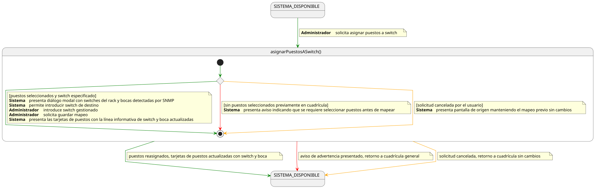
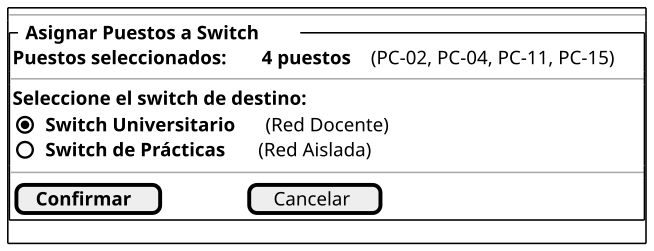

|   
|-:

# OpSys > asignarPuestosASwitch()

### Especificación

  
  
<em>Código fuente: <a href="especificacion.puml">especificacion.puml</a></em>

### Prototipo (Wireframe)

  
  
<em>Código fuente: <a href="wireframes.puml">wireframes.puml</a></em>

## Información del caso de uso

| Atributo | Valor |
| :--- | :--- |
| **Actor** | Administrador |
| **Objetivo** | Mapear y registrar la infraestructura física de red asignando imperativamente cada puesto de trabajo (`Puesto`) a un conmutador gestionado (`Switch`), vinculando la boca física detectada por telemetría SNMP (`puertoSwitch`, ej. `port14`), manteniendo documentada la topología de cableado para su visualización informativa en la tarjeta de cada puesto (`Switch: 10.10.136.13 - Boca: port14`) y permitiendo al daemon dirigir las consultas SNMP de estado de enlace (`ifOperStatus`) al conmutador e interfaz correspondientes (según ADR-004). |
| **Tipo** | Primario, esencial |
| **Nivel** | Objetivo de usuario (User-Goal Level) |

### Descripción del caso de uso

El caso de uso permite al Administrador establecer el mapeo físico imperativo entre las mesas del aula y los conmutadores del rack. Dado que la boca física es detectada y provista automáticamente por el sistema vía SNMP (`port14`, `port01`...), **no es necesario introducir ni seleccionar la boca manualmente**; el sistema presenta la boca detectada para cada puesto y el Administrador selecciona el conmutador gestionado al que están conectados:

1. **Flujo principal de asignación (`SISTEMA_DISPONIBLE`)**:
   * **Precondición:** El Administrador debe haber seleccionado previamente uno o varios puestos en la cuadrícula general del aula.
   * **Bloqueo preventivo si no hay selección:** Si no existe ningún puesto seleccionado previamente, el sistema no permite acceder al modal y presenta un aviso de advertencia indicando que se requiere seleccionar puestos antes de proceder.
   * **Apertura de modal de asignación:** Con puestos seleccionados, el Administrador solicita asignar a switch. El sistema presenta el diálogo modal de infraestructura de red:
     • Resumen de puestos seleccionados (ej. `4 puestos (PC-01, PC-02, PC-03, PC-04)`).
     • Selector del conmutador gestionado destino del rack del aula (ej. `SW-01 (10.10.136.13)`, `SW-02 (10.10.136.42)`, `SW-03 (10.10.136.39)`).
     • Tabla con los puestos y la boca física detectada por SNMP para cada uno (`port01`, `port02`, `port03`, `port04`).
     • Muestra previa de la línea informativa resultante para la tarjeta (`Switch: 10.10.136.13 - Boca: port01`).
   * **Confirmación:** El Administrador introduce el conmutador gestionado de destino y solicita guardar el mapeo. El sistema actualiza en memoria el inventario físico de los puestos y presenta en la cuadrícula general las tarjetas de los puestos con su información de switch y boca actualizada.

2. **Flujos alternativos y de excepción**:
   * **Sin puestos seleccionados:** Si el Administrador solicita la asignación sin puestos marcados en la cuadrícula panorámica, el sistema no abre el diálogo y presenta un aviso informativo de selección requerida.
   * **Cancelación de la solicitud:** Si el Administrador solicita cancelar el diálogo, el sistema retorna a la cuadrícula general sin modificar el mapeo existente.

### Conversación detallada (Estilo pySigHor)

#### Flujo principal (Puestos seleccionados y mapeo confirmado)

| Actor | Acción | Sistema | Respuesta |
| :--- | :--- | :--- | :--- |
| **Administrador** | solicita asignar puestos a switch |||
|| **Sistema** | presenta | • diálogo modal de infraestructura de red: &nbsp;&nbsp;• resumen de puestos seleccionados &nbsp;&nbsp;• selector de switch gestionado de destino &nbsp;&nbsp;• tabla de puestos con bocas físicas detectadas por SNMP &nbsp;&nbsp;• vista previa de línea informativa en tarjeta |
|| **Sistema** | permite introducir | • switch gestionado de destino |
|| **Sistema** | permite solicitar | • guardar mapeo • cancelar asignación |
| **Administrador** | introduce | • switch gestionado ||
| **Administrador** | solicita guardar mapeo |||
|| **Sistema** | presenta | • tarjetas de puestos con línea informativa de switch y boca actualizadas |

#### Flujo alternativo 1 (Sin puestos seleccionados previamente)

| Actor | Acción | Sistema | Respuesta |
| :--- | :--- | :--- | :--- |
| **Administrador** | solicita asignar puestos a switch |||
|| **Sistema** | presenta | • aviso indicando que se requiere seleccionar puestos antes de mapear |

#### Flujo alternativo 2 (Cancelación de la operación)

| Actor | Acción | Sistema | Respuesta |
| :--- | :--- | :--- | :--- |
| **Administrador** | solicita cancelar asignación |||
|| **Sistema** | presenta | • pantalla de origen manteniendo el mapeo previo sin cambios |

### Precondiciones
* El Administrador ha iniciado sesión en el sistema (`SISTEMA_DISPONIBLE`).
* Debe existir al menos un puesto físico seleccionado en la cuadrícula general.
* Existen switches gestionados registrados en el catálogo del aula con sus respectivas direcciones IP de gestión y bocas detectadas vía SNMP.

### Postcondiciones
* Los puestos físicos seleccionados quedan mapeados al conmutador gestionado con su boca física detectada por SNMP.
* La tarjeta visual de cada puesto refleja informativamente la dirección y puerto del switch (`Switch: 10.10.136.xx - Boca: port14`).
* El motor de telemetría SNMP enruta las consultas de estado de enlace (`ifOperStatus`) a la IP y boca del switch mapeado.
* El mapeo físico no altera el modo operativo global del aula (`CLASE` vs `PRACTICA`).

### Referencias
* **Diagrama de contexto de Admin:** 
  * `SISTEMA_DISPONIBLE --> SISTEMA_DISPONIBLE : asignarPuestosASwitch()`
* **Modelo del dominio:** `Laboratorio`, `Puesto`, `Host`, `Switch`, `Red`
* **Decisiones arquitectónicas:**
  * [ADR-001: Justificación y Acotamiento de Acciones, Trazabilidad y Rol Administrador](../../../../docs/adr/ADR-001-acotamiento-acciones-trazabilidad.md)
  * [ADR-004: Inclusión de la Entidad Switch, Disposición Espacial de Puestos en Cuadrícula y Aulas Híbridas](../../../../docs/adr/ADR-004-inclusion-switch-asignacion-distribuciones.md)
