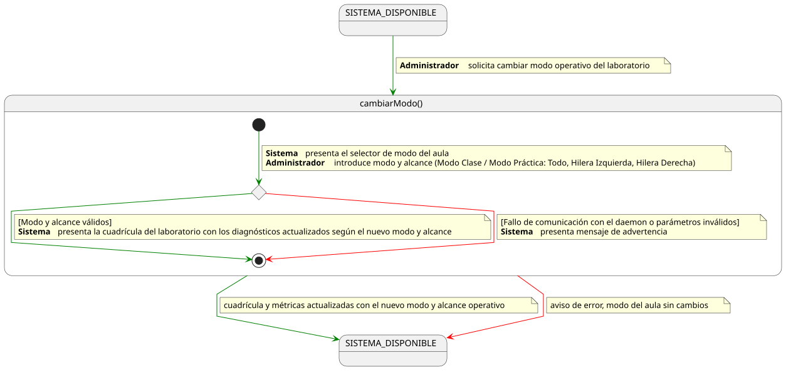
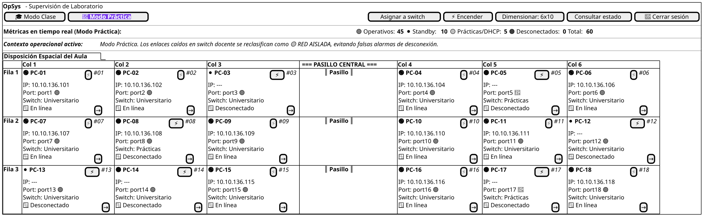

|   
|-:

# OpSys > cambiarModo()

### Especificación

  
  
<em>Código fuente: <a href="especificacion.puml">especificacion.puml</a></em>

### Prototipo (Wireframe)

  
  
<em>Código fuente: <a href="wireframes.puml">wireframes.puml</a></em>

## Información del caso de uso

| Atributo | Valor |
| :--- | :--- |
| **Actor** | Administrador |
| **Objetivo** | Conmutar el contexto operacional del laboratorio docente entre `Modo Clase` (operación habitual en red docente) y `Modo Práctica` (laboratorio en red aislada de prácticas), permitiendo delimitar el alcance de la práctica a toda el aula o a una hilera específica (separada por el pasillo central), para re-evaluar inmediatamente en memoria los diagnósticos deterministas de los puestos de trabajo sin generar alarmas erróneas de cable desconectado |
| **Tipo** | Primario, esencial |
| **Nivel** | Objetivo de usuario (User-Goal Level) |

### Descripción del caso de uso

El caso de uso modela la conmutación del contexto operacional del aula, permitiendo adaptar las reglas de clasificación determinista de la telemetría según la actividad docente que se esté desarrollando:

1. **Contextos y Alcances Operacionales del Aula:**
   * **`Modo Clase` (Operación Normal):**
     * Todos los puestos deben encontrarse conectados a la infraestructura docente ordinaria.
     * Si la boca del switch pasa a `DOWN` y el agente no conecta, se diagnostica como una anomalía física $\rightarrow$ **`🟠 DESCONECTADO` (Cable Desconectado)**.
   * **`Modo Práctica` (Sesión de Redes / Switch Aislado):**
     * Se espera que los alumnos del subgrupo de prácticas desconecten físicamente el cable de la roseta docente y lo conecten al switch secundario de prácticas (`sw-practicas`), el cual no dispone de gestión SNMP ni salida a Internet/MeshCentral.
     * El operador puede seleccionar el **alcance** de la práctica:
       * **`Toda el aula` (`COMPLETO`):** Todos los puestos del aula asumen la política de red aislada.
       * **`Hilera Izquierda` (`HILERA_IZQUIERDA`):** Únicamente los puestos de la hilera izquierda (columnas $\le \lceil C/2 \rceil$) asumen la política de red aislada; la hilera derecha permanece en monitorización normal de clase.
       * **`Hilera Derecha` (`HILERA_DERECHA`):** Únicamente los puestos de la hilera derecha (columnas $> \lceil C/2 \rceil$) asumen la política de red aislada; la hilera izquierda permanece en monitorización normal de clase.
     * En los puestos bajo alcance de práctica, al detectar la boca del switch docente en `DOWN`, el sistema deduce el cambio legítimo de contexto $\rightarrow$ **`🟡 RED AISLADA` (En Red Aislada de Prácticas)**, evitando falsas alarmas de desconexión.
     * En los puestos fuera del alcance de práctica, una caída de enlace se sigue reportando rigurosamente como **`🟠 DESCONECTADO`**.

2. **Flujo Principal:**
   * El Administrador solicita cambiar el modo operativo del aula.
   * El Administrador introduce el modo deseado (`Modo Clase` o `Modo Práctica`) y, en caso de seleccionar práctica, introduce el alcance de aplicación (`Toda el aula`, `Hilera Izquierda` o `Hilera Derecha`).
   * El sistema valida la solicitud y actualiza el contexto operacional del laboratorio y el alcance de la práctica.
   * El sistema re-evalúa el estado de los puestos de trabajo del aula en función de su ubicación física respecto al pasillo central y del alcance seleccionado.
   * El sistema presenta el selector con el modo y alcance seleccionados activos, presenta la cuadrícula del laboratorio con los diagnósticos actualizados según el nuevo modo y alcance y presenta el resumen consolidado de métricas recalculado.

3. **Flujos Alternativos y Excepcionales:**
   * **Parámetros inválidos o error de comunicación:** Si se produce un error de comunicación o los parámetros introducidos son inválidos, el sistema presenta un aviso visual de advertencia y mantiene el contexto operacional previo sin modificaciones.

### Referencias
* **Diagrama de contexto de Admin:** 
  * `SISTEMA_DISPONIBLE --> SISTEMA_DISPONIBLE : cambiarModo()`
* **Modelo del dominio:** `Laboratorio`, `Host`, `Puesto`, `Switch`, `Red`, `Estado`, `EvaluadorEstado`
* **Decisiones arquitectónicas:**
  * [ADR-001: Justificación y Acotamiento de Acciones, Trazabilidad y Rol Administrador](../../../../docs/adr/ADR-001-acotamiento-acciones-trazabilidad.md)
  * [ADR-003: Remediación GPO y Persistencia de Red](../../../../docs/adr/ADR-003-arquitectura-remediacion-gpo-exclusion-switch.md)
  * [ADR-004: Inclusión de la Entidad Switch, Disposición Espacial de Puestos en Cuadrícula y Aulas Híbridas](../../../../docs/adr/ADR-004-inclusion-switch-asignacion-distribuciones.md)
