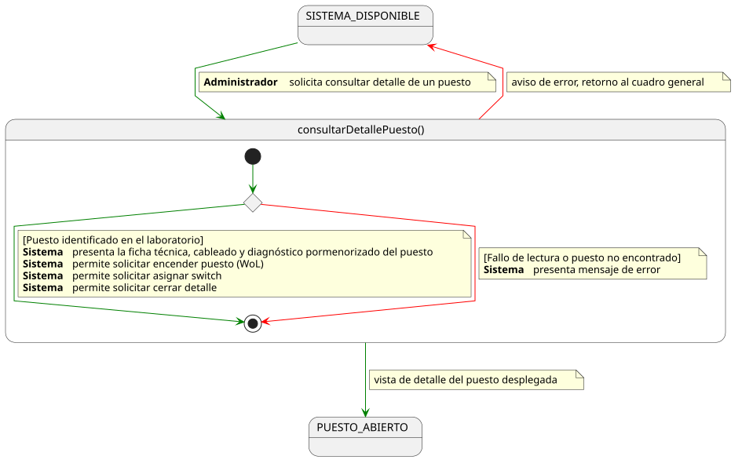
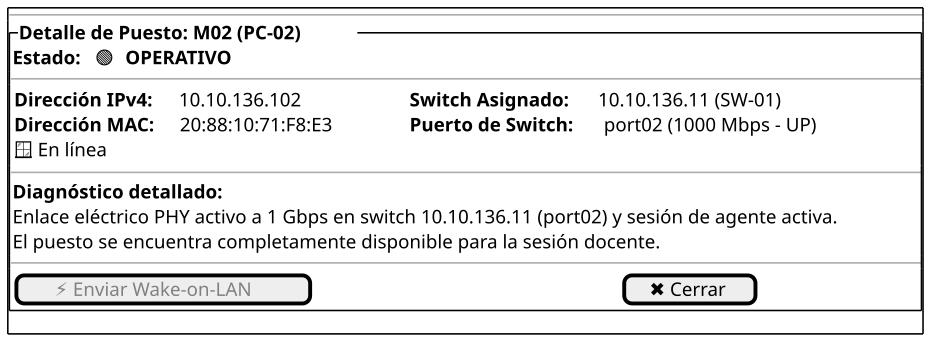

|   
|-:

# OpSys > consultarDetallePuesto()

### Especificación

  
  
<em>Código fuente: <a href="especificacion.puml">especificacion.puml</a></em>

### Prototipo (Wireframe)

  
  
<em>Código fuente: <a href="wireframes.puml">wireframes.puml</a></em>

## Información del caso de uso

| Atributo | Valor |
| :--- | :--- |
| **Actor** | Administrador |
| **Objetivo** | Inspeccionar en profundidad la ficha técnica, cableado estructurado de Capa 1, telemetría lógica de Capa 7 y desglose del diagnóstico determinista de un puesto de trabajo específico |
| **Tipo** | Primario, esencial |
| **Nivel** | Objetivo de usuario (User-Goal Level) |

### Descripción del caso de uso

El Administrador selecciona una tarjeta de puesto en el cuadro de mando general (`SISTEMA_DISPONIBLE`) para abrir su ficha técnica de inspección en profundidad, transicionando al contexto de **`PUESTO_ABIERTO`**:

1. **Cabecera y estado consolidado:**
   * El sistema presenta la cabecera modal con el nombre del equipo (`PC-02`) y el indicador semafórico determinista (`🟢 OPERATIVO`, `⚫ STANDBY`, `🟡 RED AISLADA / FALLO LÓGICO`, `🟠 DESCONECTADO`).
2. **Disposición minimalista en dos bloques (sin bordes de tabla):**
   * **Bloque izquierdo (Host y Sistema Operativo):**
     * **Dirección IPv4:** Dirección lógica en red (`10.10.136.102`).
     * **Dirección MAC:** Identificador físico de la tarjeta de red (`20:88:10:71:F8:E3`).
     * **Agente Windows:** Estado de comunicación representado directamente mediante el icono de sistema y texto conciso (`🪟 En línea` o `🪟 Fuera de línea`), sin etiquetas intermedias superfluas.
   * **Bloque derecho (Infraestructura de Red y Switch):**
     * **Switch asignado:** Dirección IP y conmutador gestionado del rack (`10.10.136.11 (SW-01)`).
     * **Puerto de switch:** Boca física detectada por SNMP y enlace eléctrico Capa 1 (`port02 (1000 Mbps - UP)`).
3. **Desglose del diagnóstico determinista:**
   * Justificación técnica clara y comprensible del porqué del estado resultante según la correlación de Capa 1 y Capa 7 con el modo operativo del aula.
4. **Acciones contextuales y remediación:**
   * **Encendido remoto (`[ ⚡ Enviar Wake-on-LAN ]`):** Habilitado en reposo `STANDBY` o `AMARILLO`. En puestos `OPERATIVO` (encendidos), figura explícitamente **desactivado** (`[ ⚡ Enviar Wake-on-LAN (Desactivado) ]`) para prevenir órdenes redundantes.
   * **Cierre de ficha (`[ ✖ Cerrar ]`):** Cierra el modal de inspección y retorna al cuadro de mando panorámico (`SISTEMA_DISPONIBLE`).

### Referencias
* **Diagrama de contexto de Admin:** 
  * `SISTEMA_DISPONIBLE --> PUESTO_ABIERTO : consultarDetallePuesto()`
  * `PUESTO_ABIERTO --> SISTEMA_DISPONIBLE : consultarEstadoPuestos()`
  * `PUESTO_ABIERTO --> PUESTO_ABIERTO : encenderPuesto()`
* **Modelo del dominio:** `Laboratorio`, `Puesto`, `Host`, `Switch`, `Red`, `Estado`, `Accion`
* **Decisiones arquitectónicas:**
  * [ADR-001: Justificación y Acotamiento de Acciones, Trazabilidad y Rol Administrador](../../../../docs/adr/ADR-001-acotamiento-acciones-trazabilidad.md)
  * [ADR-002: Acotamiento de Control de Energía por Limitación de Hardware en Clientes Dell](../../../../docs/adr/ADR-002-acotamiento-control-energia-hardware.md)
  * [ADR-004: Inclusión de la Entidad Switch, Disposición Espacial de Puestos en Cuadrícula y Aulas Híbridas](../../../../docs/adr/ADR-004-inclusion-switch-asignacion-distribuciones.md)
