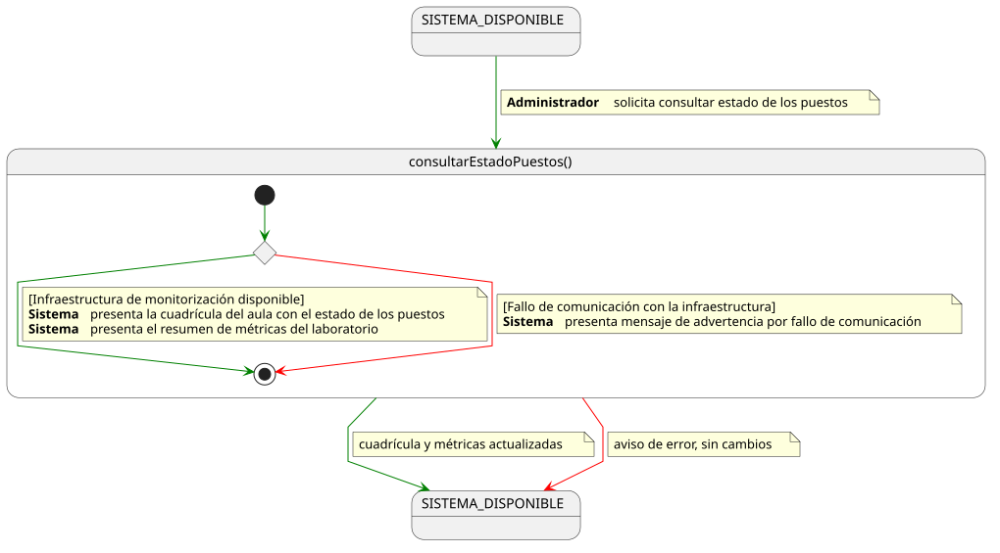
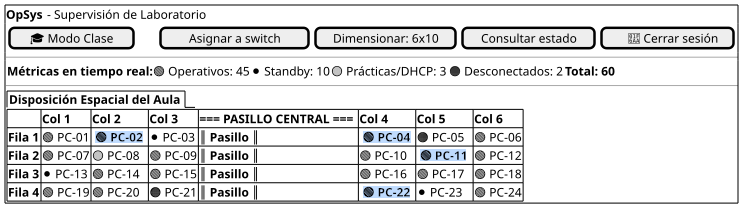

|   
|-:

# OpSys > consultarEstadoPuestos()

### Especificación

  
  
<em>Código fuente: <a href="especificacion.puml">especificacion.puml</a></em>

### Prototipo (Wireframe)

  
  
<em>Código fuente: <a href="wireframes.puml">wireframes.puml</a></em>

## Información del caso de uso

| Atributo | Valor |
| :--- | :--- |
| **Actor** | Administrador |
| **Objetivo** | Consultar en tiempo real la cuadrícula física de puestos con su estado de conexión, telemetría física y lógica, y las métricas consolidadas del laboratorio |
| **Tipo** | Primario, esencial |
| **Nivel** | Objetivo de usuario (User-Goal Level) |

### Descripción del caso de uso

El Administrador accede al cuadro de mando principal del laboratorio (`SISTEMA_DISPONIBLE`) para supervisar la salud de los puestos y el aula en tiempo real:

1. **Cuadrícula espacial con pasillo central:** El sistema presenta los puestos organizados por filas y columnas, divididos en dos hileras simétricas (izquierda y derecha) separadas físicamente por un pasillo central (`=== PASILLO CENTRAL ===` / `║  Pasillo  ║`), reflejando la distribución real de las mesas del laboratorio.
2. **Estructura ampliada de cada tarjeta de puesto:** Cada mesa de trabajo se representa mediante una tarjeta de alta visibilidad que concentra la telemetría esencial en cinco datos clave:
   - **Nombre del puesto, acción de encendido e identificador físico:** Indicador semafórico del diagnóstico determinista (`🟢` Operativo, `⚫` Standby, `🟡` Red Aislada / Fallo Lógico, `🟠` Desconectado), nombre lógico del host (`PC-01`), botón compacto de encendido Wake-on-LAN (`[ ⚡ ]`) activo en equipos en Standby o Prácticas y deshabilitado (`[ ⚡ ]` atenuado) en equipos ya encendidos o desconectados, y número de slot físico (`#01`).
   - **Dirección IP:** Dirección IPv4 en red (`IP: 10.10.136.101`) o indicación vacía (`IP: ---`) en equipos apagados o sin arrendamiento DHCP.
   - **Puerto del switch físico:** Boca física en el switch e indicador semafórico de enlace eléctrico de Capa 1 (`Port: port1 🟢` para enlace activo UP o `Port: port5 🔴` para enlace caído DOWN), optimizando el espacio visual de la tarjeta y evitando desbordamientos de texto.
   - **Switch asignado:** Conmutador gestionado al que pertenece el puesto físico identificado por su dirección IP (`Switch: 10.10.136.11` o `Switch: 10.10.136.13`).
   - **Disponibilidad del agente y acceso al detalle:** Conexión viva de Capa 7 a nivel del sistema operativo presentada de forma minimalista (`🪟 En línea` o `🪟 Desconectado`) acompañada en su extremo derecho de un botón interactivo de flecha (`[→]`) para abrir directamente la inspección en `consultarDetallePuesto()`.
3. **Ausencia deliberada de descripción de estado en la tarjeta:** Para optimizar el espacio visual de supervisión panorámica y evitar sobrecarga cognitiva, la tarjeta prescinde de leyendas textuales largas de estado en su pie; dicha información y controles avanzados se reservan para la vista de detalle al interactuar con el puesto.
4. **Selección interactiva de tarjeta completa:** Se prescinde de casillas de verificación individuales (*checkbox*), haciendo que toda la tarjeta sea seleccionable directamente mediante clic (representada con resaltado de fondo azul `<back:#bfdbfe>`). Esto permite marcar puestos individuales o en bloque para operaciones masivas mediante los botones superiores `[ Asignar a switch ]` y `[ ⚡ Encender ]`.
5. **Cabecera y métricas globales:** La barra superior presenta el título del sistema (`OpSys - Supervisión de Laboratorio`), el selector de modo operativo contextual (`[ 🎓 Modo Clase ]` / `[ 🧪 Modo Práctica ]`) a la izquierda, los botones de acción global (`[ Asignar a switch ]`, `[ ⚡ Encender ]`, `[Dimensionar: 6x10]`, `[Consultar estado]`, `[🚪 Cerrar sesión]`) y la barra de métricas consolidadas en tiempo real (Total, Operativos, Standby, Prácticas/DHCP y Desconectados).

### Referencias
* **Diagrama de contexto de Admin:** `SISTEMA_DISPONIBLE --> SISTEMA_DISPONIBLE : consultarEstadoPuestos()`
* **Modelo del dominio:** `Laboratorio`, `Puesto`, `Host`, `Switch`, `Estado`
* **Decisiones arquitectónicas:**
  * [ADR-001: Justificación y Acotamiento de Acciones, Trazabilidad y Rol Administrador](../../../../docs/adr/ADR-001-acotamiento-acciones-trazabilidad.md)
  * [ADR-004: Inclusión de la Entidad Switch, Disposición Espacial de Puestos en Cuadrícula y Aulas Híbridas](../../../../docs/adr/ADR-004-inclusion-switch-asignacion-distribuciones.md)
