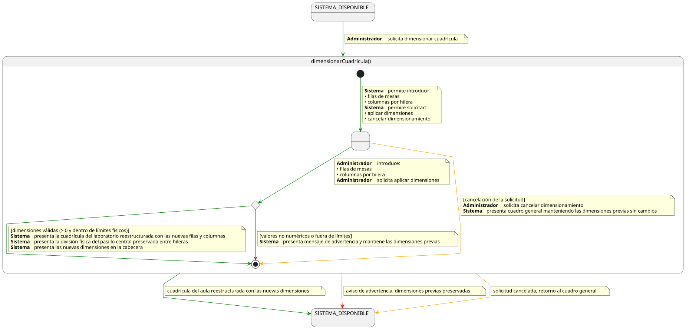

|   
|-:

# OpSys > dimensionarCuadricula()

### Especificación

  
  
<em>Código fuente: <a href="especificacion.puml">especificacion.puml</a></em>

### Prototipo (Wireframe)

  
  
<em>Código fuente: <a href="wireframes.puml">wireframes.puml</a></em>

## Información del caso de uso

| Atributo | Valor |
| :--- | :--- |
| **Actor** | Administrador |
| **Objetivo** | Configurar dinámicamente las dimensiones espaciales de la cuadrícula de supervisión del laboratorio (número de filas de mesas y número de columnas por hilera) mediante un diálogo modal dedicado, asegurando la división física del pasillo central entre hileras para adaptar el plano visual a diferentes configuraciones o layouts de mesas del aula real |
| **Tipo** | Primario, esencial |
| **Nivel** | Objetivo de usuario (User-Goal Level) |

### Descripción del caso de uso

El caso de uso modela el ajuste y dimensionado de la cuadrícula visual del aula mediante un modal interactivo para representar fielmente la distribución física de mesas del laboratorio:

1. **Invariantes Espaciales y Pasillo Central (ADR-004):**
   * El plano espacial del laboratorio organiza los puestos de trabajo en dos bloques simétricos (hilera izquierda e hilera derecha) divididos de forma permanente por un pasillo central explícito (`=== PASILLO CENTRAL ===` / `║ Pasillo ║`).
   * La geometría se parametriza mediante dos dimensiones independientes:
     * **Filas (`filas`):** Cantidad de hileras de mesas en profundidad (ej. 5, 6, 7).
     * **Columnas por hilera (`columnas_hilera`):** Cantidad de puestos por fila a cada lado del pasillo central (ej. 3, 4, 5). El total de columnas resultante en el aula es siempre $2 \times \text{columnas\_hilera}$.

2. **Flujo Principal:**
   * El Administrador solicita dimensionar la cuadrícula del aula.
   * El sistema presenta el diálogo de dimensionamiento con las dimensiones actuales en los campos de entrada (`Filas de mesas` y `Columnas por hilera`), la estructura resultante y la capacidad máxima de puestos físicos.
   * El sistema permite introducir el número de filas y columnas por hilera, y permite solicitar aplicar las dimensiones o cancelar.
   * El Administrador introduce las nuevas dimensiones deseadas y solicita aplicar los cambios.
   * El sistema valida los datos introducidos, reestructura la cuadrícula del laboratorio preservando los puestos físicos asignados y el pasillo central divisorio entre hileras, cierra el diálogo y presenta la nueva disposición espacial con las dimensiones configuradas.

3. **Flujos Alternativos y Excepcionales:**
   * **Dimensiones inválidas o fuera de rango:** Si el Administrador introduce valores menores a 1, no numéricos o incompatibles con los límites del laboratorio, el sistema presenta un aviso visual de advertencia y mantiene las dimensiones previas de la cuadrícula sin aplicar modificaciones.
   * **Cancelación de la solicitud:** Si el Administrador solicita cancelar la operación, el sistema cierra el diálogo y retorna al cuadro general sin modificar las dimensiones del laboratorio.

### Referencias
* **Diagrama de contexto de Admin:** 
  * `SISTEMA_DISPONIBLE --> SISTEMA_DISPONIBLE : dimensionarCuadricula()`
* **Modelo del dominio:** `Laboratorio`, `Puesto`, `Host`
* **Decisiones arquitectónicas:**
  * [ADR-004: Inclusión de la Entidad Switch, Disposición Espacial de Puestos en Cuadrícula y Aulas Híbridas](../../../../docs/adr/ADR-004-inclusion-switch-asignacion-distribuciones.md)
