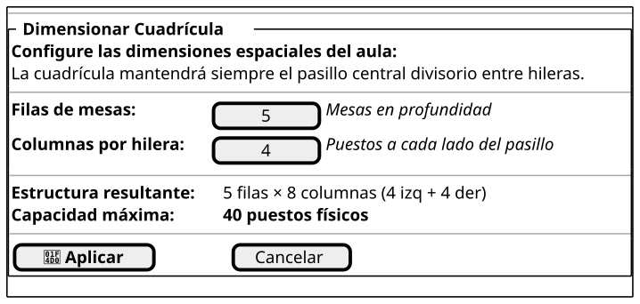

[Al inicio](/README.md) / [Modelo del dominio](/RUP/00-modelo-del-dominio/README.md) / [Requisitos](/RUP/01-requisitos/README.md) / [Detalle de Casos de Uso](../README.md) / Análisis / Diseño / Desarrollo OpSys -- Plataforma de supervisión y observabilidad en tiempo real de puestos de trabajo en laboratorios docentes compartidos.

# OpSys > dimensionarCuadricula()

|🏠️|DdC|Detalle|Análisis|Diseño|Desarrollo|Pruebas|
|:-:|:-:|:-:|:-:|:-:|:-:|:-:|
|[Inicio](/README.md)|[DdC](/RUP/01-requisitos/00-actores-casos-uso/README.md#2-diagrama-de-contexto)|[Detalle](../README.md)|Pendiente|Pendiente|Pendiente|Pendiente|

### Especificación

  
  
<em>Código fuente: <a href="especificacion.puml">especificacion.puml</a></em>

### Prototipo (Wireframe)

  
  
<em>Código fuente: <a href="wireframes.puml">wireframes.puml</a></em>

## Información del caso de uso

| Atributo | Valor |
| :--- | :--- |
| **Actor** | Administrador |
| **Objetivo** | Configurar dinámicamente las dimensiones espaciales de la cuadrícula de supervisión del laboratorio (número de filas de mesas y número de columnas por hilera) mediante un diálogo modal dedicado, asegurando la división física del pasillo central entre hileras para adaptar el plano visual a diferentes configuraciones o layouts de mesas del aula real |
| **Tipo** | Primario, esencial |
| **Nivel** | Objetivo de usuario (User-Goal Level) |

### Descripción del caso de uso

El caso de uso modela el ajuste y dimensionado de la cuadrícula visual del aula mediante un modal interactivo para representar fielmente la distribución física de mesas del laboratorio:

1. **Invariantes Espaciales y Pasillo Central (ADR-004):**
   * El plano espacial del laboratorio organiza los puestos de trabajo en dos bloques simétricos (hilera izquierda e hilera derecha) divididos de forma permanente por un pasillo central explícito (`=== PASILLO CENTRAL ===` / `║ Pasillo ║`).
   * La geometría se parametriza mediante dos dimensiones independientes:
     * **Filas (`filas`):** Cantidad de hileras de mesas en profundidad (ej. 5, 6, 7).
     * **Columnas por hilera (`columnas_hilera`):** Cantidad de puestos por fila a cada lado del pasillo central (ej. 3, 4, 5). El total de columnas resultante en el aula es siempre $2 \times \text{columnas\_hilera}$.

2. **Flujo Principal:**
   * El Administrador solicita dimensionar la cuadrícula pulsando en el botón de control en la barra de acciones superior (`[ Dimensionar: Fx(2C) ]`).
   * El sistema presenta el diálogo modal **Dimensionar Cuadrícula** con los valores numéricos actuales en los campos de entrada (`Filas de mesas` y `Columnas por hilera`), junto al cálculo previo de la estructura resultante y capacidad máxima de puestos físicos.
   * El Administrador introduce los nuevos valores numéricos deseados y solicita aplicar las dimensiones (`[ 📐 Aplicar ]`).
   * El sistema valida los datos introducidos, actualiza la geometría del aula en memoria y reestructura dinámicamente las celdas de la cuadrícula, preservando los puestos físicos y las asignaciones de equipos existentes sin pérdida de información.
   * El sistema cierra el modal, presenta la nueva disposición espacial con las dimensiones configuradas manteniendo el pasillo central, y actualiza la etiqueta informativa del botón de la cabecera.
   * El sistema difunde la actualización a través del canal SSE para reflejar el nuevo layout en tiempo real en todos los clientes conectados.

3. **Flujos Alternativos y Excepcionales:**
   * **Dimensiones inválidas o fuera de rango:** Si el Administrador introduce valores menores a 1, no numéricos o que excedan los límites físicos configurables, el sistema presenta un aviso visual de advertencia y mantiene las dimensiones previas de la cuadrícula sin aplicar modificaciones.
   * **Cancelación de la solicitud:** Si el Administrador pulsa `[ Cancelar ]`, cierra el modal o pulsa la tecla `Escape`, el sistema retorna al cuadro general sin modificar las dimensiones del laboratorio.

### Referencias
* **Diagrama de contexto de Admin:** 
  * `SISTEMA_DISPONIBLE --> SISTEMA_DISPONIBLE : dimensionarCuadricula()`
* **Modelo del dominio:** `Laboratorio`, `Puesto`, `Host`
* **Decisiones arquitectónicas:**
  * [ADR-004: Inclusión de la Entidad Switch, Disposición Espacial de Puestos en Cuadrícula y Aulas Híbridas](../../../../docs/adr/ADR-004-inclusion-switch-asignacion-distribuciones.md)
