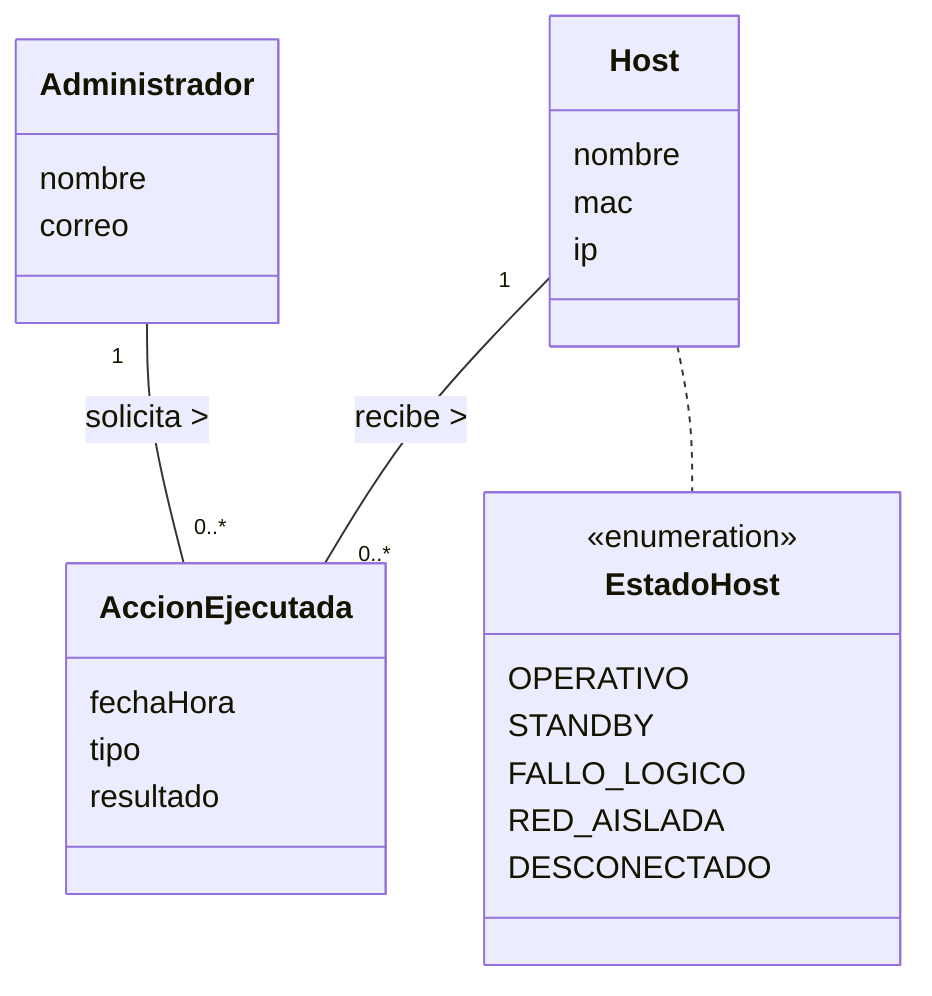

# ADR-001: Justificación y Acotamiento de Acciones, Trazabilidad y Rol Administrador

* **Proyecto:** OpSys / Mesh-Panel — Observabilidad y Supervisión de Laboratorio Docente
* **Fecha:** 2026-11-10
* **Fase:** RUP Inicio (Inception) — Modelo del Dominio
* **Estado:** Aprobado / Acotado por Negocio

---

## 1. Contexto y Problema

En las versiones preliminares del Modelo del Dominio (`diagrama-clases.puml`), se incluyó una clase `Accion` asociada por dependencia a `Estado`:
```plantuml
Host "1" *-- "1" Estado : "se encuentra en"
Estado ..> Accion : "habilita"
```

Dicha clase encapsulaba atributos como `tipo` y `descripcion` con el fin de trasladar al frontend qué botón interactivo presentar (`WoL` o `Apagar`).

Sin embargo, desde la perspectiva del análisis conceptual en RUP:
1. **Acoplamiento de Vista en el Dominio:** Modelar una clase con la única finalidad de gobernar la presentación de controles en la interfaz de usuario traslada responsabilidades de la Vista y del patrón *Command* al modelo del dominio.
2. **Reificación Transaccional:** Una acción únicamente se modela como clase conceptual de negocio cuando el sistema requiere persistir una transacción histórica inmutable (auditoría de eventos con marca temporal, resultado y autoría).

---

## 2. Decisión de Negocio y Delimitación de Alcance

Conforme al alcance acordado para el sistema:
1. **Operador Único:** La plataforma opera bajo la administración de un único responsable de aula.
2. **Ausencia de Auditoría de Acciones:** El sistema no requiere persistencia de logs de autoría ni trazabilidad histórica de órdenes ejecutadas.
3. **Principio YAGNI (*You Aren't Gonna Need It*):** Se descarta la incorporación de conceptos que no correspondan a requerimientos funcionales expresos.

### Decisiones Adoptadas:
* **Exclusión de `Administrador` del Modelo de Clases:** El Administrador actúa como **Actor externo** en la frontera del sistema dentro del catálogo de Casos de Uso.
* **Retiro de la Clase `Accion` del Diagrama de Clases:** Las operaciones operativas (`Encender WoL`) constituyen **eventos y transiciones** del comportamiento dinámico en el Diagrama de Estados del Host y servicios en los Casos de Uso.
* **Representación del Estado mediante Enumerado Conceptual:** El ciclo de vida del equipo se expresa mediante el enumerado `EstadoHost` (`OPERATIVO`, `STANDBY`, `FALLO_LOGICO`, `RED_AISLADA`, `DESCONECTADO`), asociado conceptualmente a `Host`.

---

## 3. Arquitectura Alternativa (Extensión para Trazabilidad)

En caso de que futuros requerimientos demanden auditoría multi-usuario, el modelo se expande de forma aditiva mediante el patrón estándar de entidades transaccionales:



### Características del Patrón Transaccional:
* **Trípode Transaccional:** Emisor (`Administrador`) $\to$ Hecho consumado (`AccionEjecutada`) $\to$ Objeto afectado (`Host`).
* **Multiplicidades:** `Administrador "1" -- "0..*" AccionEjecutada` y `Host "1" -- "0..*" AccionEjecutada`.
* **Inmutabilidad:** La transacción persiste `fechaHora`, `tipo` y `resultado`, garantizando la auditoría histórica sin sobrecargar la entidad `Host`.

---

## 4. Justificación Metodológica

El acotamiento preserva una separación nítida entre disciplinas de RUP:
* El **Diagrama de Clases** describe conceptos estáticos del negocio (`Laboratorio`, `Puesto`, `Host`, `Red`).
* El **Diagrama de Estados** modela las transiciones y eventos del ciclo de vida del equipo informático.
* Los **Casos de Uso** definen las operaciones invocables por los actores en la interfaz de supervisión.
