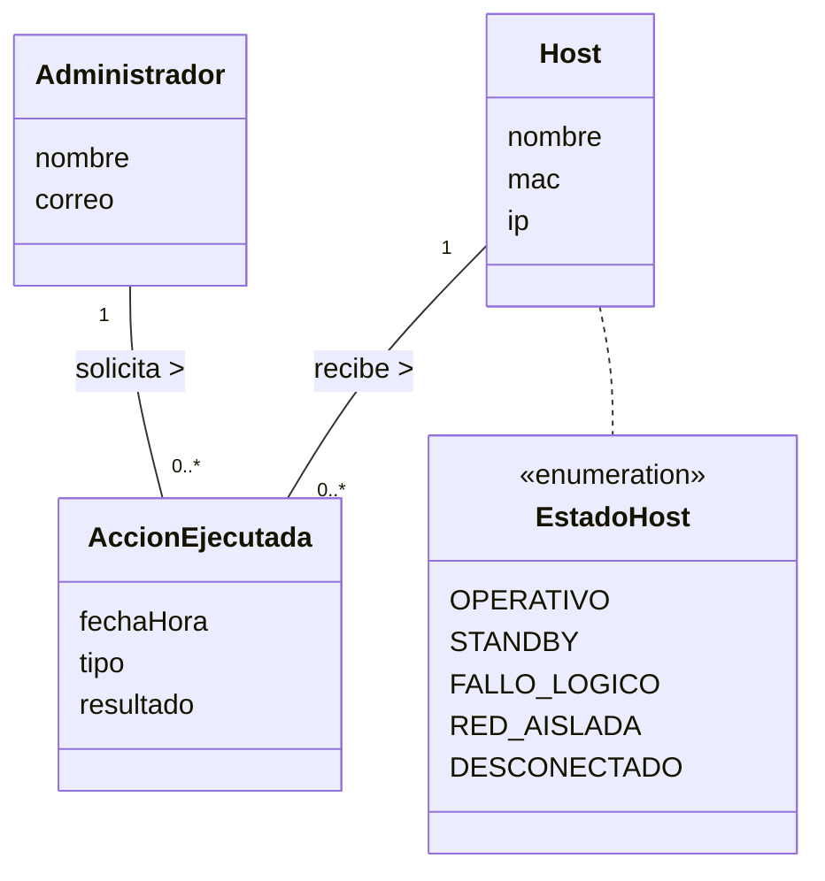

# ADR-001: Justificación y Acotamiento de Acciones, Trazabilidad y Rol Administrador

* **Proyecto:** OpSys / Mesh-Panel — Observabilidad y Supervisión de Laboratorio Docente
* **Fecha:** 2026-11-10
* **Fase:** RUP Inicio (Inception) — Modelo del Dominio
* **Estado:** Aprobado / Acotado por Negocio

---

## 1. Contexto y Problema

En las versiones preliminares del Modelo del Dominio (`diagrama-clases.puml`), se incluyó una clase `Accion` asociada por dependencia a `Estado`:
```plantuml
Host "1" *-- "1" Estado : "se encuentra en"
Estado ..> Accion : "habilita"
```

Dicha clase encapsulaba atributos como `tipo` y `descripcion` con el fin de trasladar al frontend qué botón interactivo presentar (`WoL` o `Apagar`).

Sin embargo, desde la perspectiva del análisis conceptual en RUP:
1. **Acoplamiento de Vista en el Dominio:** Modelar una clase con la única finalidad de gobernar la presentación de controles en la interfaz de usuario traslada responsabilidades de la Vista y del patrón *Command* al modelo del dominio (Larman [1], Evans [2]).
2. **Reificación Transaccional:** Una acción únicamente se modela como clase conceptual de negocio cuando el sistema requiere persistir una transacción histórica inmutable (auditoría de eventos con marca temporal, resultado y autoría) (Fowler [3]).

---

## 2. Decisión de Negocio y Delimitación de Alcance

Conforme al alcance acordado para el sistema:
1. **Operador Único:** La plataforma opera bajo la administración de un único responsable de aula.
2. **Ausencia de Auditoría de Acciones:** El sistema no requiere persistencia de logs de autoría ni trazabilidad histórica de órdenes ejecutadas (Pillo-Guanoluisa et al. [6]).
3. **Principio YAGNI (*You Aren't Gonna Need It*):** Se descarta la incorporación de conceptos que no correspondan a requerimientos funcionales expresos.

### Decisiones Adoptadas:
* **Exclusión de `Administrador` del Modelo de Clases:** El Administrador actúa como **Actor externo** en la frontera del sistema dentro del catálogo de Casos de Uso [1].
* **Retiro de la Clase `Accion` del Diagrama de Clases:** Las operaciones operativas (`Encender WoL`) constituyen **eventos y transiciones** del comportamiento dinámico en el Diagrama de Estados del Host y servicios en los Casos de Uso (Piseth et al. [4], Mauro & Schmidt [5]).
* **Representación del Estado mediante Enumerado Conceptual:** El ciclo de vida del equipo se expresa mediante el enumerado `EstadoHost` (`OPERATIVO`, `STANDBY`, `FALLO_LOGICO`, `RED_AISLADA`, `DESCONECTADO`), asociado conceptualmente a `Host`.

---

## 3. Arquitectura Alternativa (Extensión para Trazabilidad)

En caso de que futuros requerimientos demanden auditoría multi-usuario, el modelo se expande de forma aditiva mediante el patrón estándar de entidades transaccionales [3]:



### Características del Patrón Transaccional:
* **Trípode Transaccional:** Emisor (`Administrador`) $\to$ Hecho consumado (`AccionEjecutada`) $\to$ Objeto afectado (`Host`) [3].
* **Multiplicidades:** `Administrador "1" -- "0..*" AccionEjecutada` y `Host "1" -- "0..*" AccionEjecutada`.
* **Inmutabilidad:** La transacción persiste `fechaHora`, `tipo` y `resultado`, garantizando la auditoría histórica sin sobrecargar la entidad `Host` (Fowler [3], Pillo-Guanoluisa et al. [6]).

---

## 4. Justificación Metodológica

El acotamiento preserva una separación nítida entre disciplinas de RUP [1]:
* El **Diagrama de Clases** describe conceptos estáticos del negocio (`Laboratorio`, `Puesto`, `Host`, `Red`) [2].
* El **Diagrama de Estados** modela las transiciones y eventos del ciclo de vida del equipo informático [4].
* Los **Casos de Uso** definen las operaciones invocables por los actores en la interfaz de supervisión [1].

---

## 5. Referencias Bibliográficas

* **[1]** C. Larman, *Applying UML and Patterns: An Introduction to Object-Oriented Analysis and Design and Iterative Development*, 3rd ed. Upper Saddle River, NJ: Prentice Hall, 2004.
* **[2]** E. Evans, *Domain-Driven Design: Tackling Complexity in the Heart of Software*. Boston, MA: Addison-Wesley, 2003.
* **[3]** M. Fowler, *Patterns of Enterprise Application Architecture*. Boston, MA: Addison-Wesley, 2002.
* **[4]** C. Piseth, A. Oxley, and L. T. Jung, "Dynamic PC power state transitioning based on a monitoring service," in *Proc. 2012 International Conference on Computer & Information Science (ICCIS)*, Kuala Lumpur, Malaysia, 2012, vol. 1, pp. 237–241, doi: [10.1109/ICCISci.2012.6297247](https://doi.org/10.1109/ICCISci.2012.6297247).
* **[5]** D. Mauro and K. Schmidt, *Essential SNMP*, 2nd ed. Sebastopol, CA: O'Reilly Media, 2005.
* **[6]** G. Pillo-Guanoluisa, C. A. Cárdenas, and D. S. Benítez, "Centralized Network Monitoring System in Access Switches Under the FCAPS Model: A Case Study," in *Proc. 2025 IEEE Seventh Ecuador Technical Chapters Meeting (ETCM)*, Cuenca, Ecuador, 2025, pp. 1–6, doi: [10.1109/ETCM67548.2025.11304414](https://doi.org/10.1109/ETCM67548.2025.11304414).
