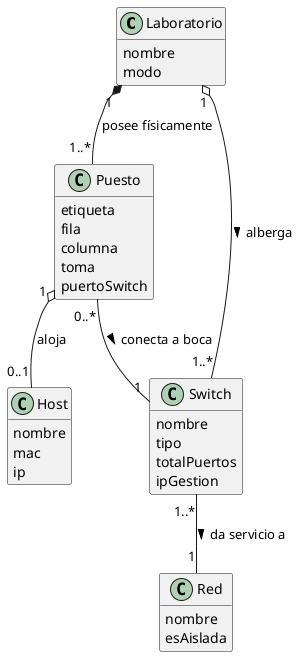

<div align=right>

|[](/README.md) [](/RUP/README.md) [](/RUP/00-modelo-del-dominio/README.md) [](/RUP/01-requisitos/README.md) [](/RUP/01-requisitos/01-detalle-casos-uso/README.md) [](/docs/matriz-documental-general.md) [](/docs/adr/README.md)
|-:

</div>

# ADR-004: Inclusión de la Entidad Switch, Disposición Espacial de Puestos en Cuadrícula y Soporte para Aulas Híbridas

* **Proyecto:** OpSys / Mesh-Panel — Observabilidad y Supervisión de Laboratorio Docente
* **Fecha:** 2026-11-14
* **Fase:** RUP Inicio (Inception) — Modelo del Dominio y Arquitectura
* **Estado:** Aprobado / Acordado con Dirección Académica
* **Supera a:** [ADR-003: Decisión 2 (Exclusión del Switch del Modelo del Dominio)](ADR-003-arquitectura-remediacion-gpo-exclusion-switch.md)
* **Documentos complementarios:**
  * [ADR-001: Justificación y Acotamiento de Acciones](ADR-001-acotamiento-acciones-trazabilidad.md)
  * [ADR-002: Acotamiento de Control de Energía y Hardware Dell](ADR-002-acotamiento-control-energia-hardware.md)
  * [ADR-003: Remediación GPO y Persistencia de Red](ADR-003-arquitectura-remediacion-gpo-exclusion-switch.md)
  * [Modelo de Dominio RUP (Clases y Objetos)](../../RUP/00-modelo-del-dominio/README.md)
  * [Matriz Documental General](../../docs/matriz-documental-general.md)

---

## 1. Contexto y Justificación del Cambio

En [ADR-003 (Decisión 2)](ADR-003-arquitectura-remediacion-gpo-exclusion-switch.md) se acordó excluir la entidad `Switch` del dominio bajo el argumento de que el sistema no es un software NMS (*Network Management System*) y que el switch secundario de prácticas constituía un "objeto ciego" sin telemetría SNMP. Bajo dicha premisa, el contexto operacional se resolvía mediante una bandera global en el aggregate root: `Laboratorio.modo = 'CLASE' | 'PRACTICA'`.

### 1.1. La Limitación del Aula Homogénea Frente a la Realidad Docente
El modelo global presupone que los 56 puestos del aula operan siempre bajo una política idéntica (todos en red universitaria o todos en red aislada). Sin embargo, la dinámica pedagógica real en asignaturas de redes e ingeniería de sistemas exige con frecuencia el escenario de **Aula Híbrida o por Subgrupos**:
* **Subgrupo A (ej. 20 puestos / Filas 1 a 3):** Realiza prácticas de laboratorio de enrutamiento y conmutación $\rightarrow$ Se conectan al Switch de Prácticas (Red Aislada).
* **Subgrupo B (ej. 20 puestos / Filas 4 a 6):** Sigue la sesión teórica ordinaria, realiza tareas de desarrollo o exámenes $\rightarrow$ Permanece en el Switch Principal Docente (Red Universitaria).

### 1.2. El Fallo del Diagnóstico con Modo Global
Si el aula se encuentra en un escenario híbrido y el estado del laboratorio es global:
1. **Falso Positivo en `CLASE`:** Si el aula está en `Modo Clase`, los 20 puestos del Subgrupo A (que legítimamente han cambiado su cable a la red de prácticas) provocan la caída de la boca en el switch docente, marcándose erróneamente en alarma **`DESCONECTADO`** (naranja).
2. **Falso Negativo en `PRACTICA`:** Si el aula se conmuta a `Modo Práctica`, cualquier desconexión accidental o avería de cable en los puestos del Subgrupo B se clasifica falsamente como **`RED_AISLADA`** (amarillo), enmascarando la pérdida real de conectividad en puestos que debían estar operativos en red universitaria.

---

## 2. Decisión Arquitectónica 1: Incorporación de la Entidad `Switch` en el Dominio

Se revoca la Decisión 2 de ADR-003 y se incorpora formalmente la entidad `Switch` en el Modelo del Dominio de clases conceptuales (Evans [1], Larman [2]). 

Lejos de ser un mero contenedor pasivo o DTO anémico, la entidad `Switch` asume responsabilidades e **invariantes de integridad física y de negocio**:

```
┌────────────────────────────────────────────────────────┐
│                        Switch                          │
├────────────────────────────────────────────────────────┤
│ - id: String                                           │
│ - nombre: String                                       │
│ - tipo: TipoSwitch (GESTIONADO | NO_GESTIONADO)        │
│ - totalPuertos: Integer                                │
│ - ipGestion: String [0..1]                             │
│ - puertosOcupados: Map<Integer, String>                │
├────────────────────────────────────────────────────────┤
│ + conectarPuesto(puerto: Integer, puestoId: String)    │
│ + desconectarPuesto(puerto: Integer)                   │
│ + esGestionado(): Boolean                              │
│ + esperaMeshCentral(): Boolean                         │
│ + puertosLibres(): Integer                             │
└────────────────────────────────────────────────────────┘
```

### 2.1. Invariantes de Dominio Garantizados por `Switch`
1. **Invariante de Capacidad Física:** El puerto a conectar debe estar estrictamente acotado en el rango físico del hardware ($1 \le \text{puerto} \le \text{totalPuertos}$).
2. **Invariante de No-Colisión Física:** Un puerto físico de un switch no puede tener dos rosetas o cables conectados simultáneamente. La operación `conectarPuesto(puerto, puestoId)` rechaza transaccionalmente cualquier solape.
3. **Semántica de Conectividad y Aislamiento:**
   * Si `tipo == GESTIONADO`: Posee dirección IP (`ipGestion`) y habilita telemetría de Capa 1 vía SNMP.
   * Si `tipo == NO_GESTIONADO`: Carece de IP (`ipGestion == null`) y representa el conmutador ciego de prácticas.
   * La operación `esperaMeshCentral()` devuelve `false` si el switch da servicio a una red aislada, desacoplando la política del aggregate root.

---

## 3. Decisión Arquitectónica 2: Disposición Espacial de Puestos en Cuadrícula y Descarte de `Distribucion` como Entidad

Se evalúa si la disposición del aula debe modelarse mediante una entidad adicional de clases (`Distribucion`).

### 3.1. Dictamen de Dominio y Principio YAGNI (*You Aren't Gonna Need It*)
1. **Lenguaje Ubicuo del Cliente (Evans [1], Larman [2]):**  
   El cliente/docente nunca requirió un catálogo abstracto de plantillas persistentes con histórico o CRUD de "Distribuciones". El requerimiento real del aula consiste en:
   * Generar visualmente la cuadrícula física del laboratorio a partir de sus dimensiones: $\text{Filas } (F) \times \text{Columnas } (C)$ con un **pasillo central**.
   * Seleccionar bloques de puestos en dicha cuadrícula (ej. 20 puestos) para asignarlos a uno u otro switch.
2. **Suficiencia y Cohesión de `Puesto`:**  
   La plaza física (`Puesto`) ya encapsula de forma natural las coordenadas espaciales del aula:
   $$\text{Puesto} \big(\text{fila}, \text{columna}, \text{toma}, \text{puertoSwitch}\big)$$
   El laboratorio posee físicamente dichos puestos (`Laboratorio "1" *-- "1..*" Puesto`). Crear una clase intermedia `Distribucion` introduce sobreingeniería (complejidad accidental) sin aportar nuevo comportamiento de negocio.
3. **Persistencia Directa en Base de Datos:**  
   La asignación del switch no requiere tablas intermedias de plantillas: cada puesto guarda su clave foránea al switch asignado (`puestos.switch_id`). Una reconfiguración de subgrupos se traduce en una actualización directa sobre la colección de puestos:
   $$\text{UPDATE puestos SET switch\_id = 'sw-practicas' WHERE fila IN (1, 2, 3);}$$

### 3.2. Especificación de la Vista en Cuadrícula Dinámica y Asignación Granular de Switches
* **Dimensionamiento Dinámico por el Administrador:** La interfaz y el backend no imponen un número rígido de puestos. El administrador del panel define en tiempo de ejecución las dimensiones de la cuadrícula: $F \text{ filas} \times C \text{ columnas}$ (ej. $5 \times 8 = 40$, $6 \times 10 = 60$, o cualquier valor configurado), desplegando inmediatamente el mapa de mesas físicas.
* **El Pasillo Central como Regla Estructural de Presentación:** Divide dinámicamente la cuadrícula en dos hileras simétricas:
  * **Hilera Izquierda:** Columnas $1 \dots \lceil C/2 \rceil$.
  * **Hilera Derecha:** Columnas $\lceil C/2 \rceil + 1 \dots C$.
* **Enlace Granular e Individual por Puesto (Rechazo de Modos/Presets Fijos):** No existen modos fijos ("modo híbrido 20/20" o "modo completo"). En su lugar:
  * **Por puesto individual:** Cada puesto físico posee un selector interactivo que permite enlazarlo a demanda a cualquier conmutador del catálogo (`Switch Docente` vs `Switch Prácticas`).
  * **Por rango/bloque:** El administrador puede aplicar asignaciones masivas a rangos arbitrarios de puestos, permitiendo cualquier proporción operativa requerida por la sesión docente (ej. $20-20$, $5-50$, $10-30$, etc.).
  * Cada puesto preserva su mapeo físico de cableado (`puertoSwitch` y roseta `toma`).

### 3.3. Mapeo Transitivo Host $\rightarrow$ Puesto $\rightarrow$ Switch y Normalización (3FN)
En la realidad física del aula, un equipo informático (`Host`) no se conecta directamente al switch del rack; se coloca sobre una mesa (`Puesto`) que posee una roseta física (`toma`) parcheada a un puerto del conmutador (`Switch`).

Por tanto, el modelo de datos y de dominio formaliza una **navegación transitiva estricta**:
$$\text{Host} \xrightarrow{\text{aloja}} \text{Puesto} \xrightarrow{\text{conecta a}} \text{Switch}$$

1. **Prevención de Anomalías de Actualización:** Si se reubica físicamente la torre de un PC a otra mesa del aula, la conexión de red y la boca del switch **no se mueven con la torre**, sino que permanecen fijadas a la roseta de la mesa. Establecer una relación directa `Host -- Switch` violaría la 3ª Forma Normal (3FN), generando redundancia y riesgos de inconsistencia ante traslados de hardware.
2. **Esquema Relacional Canónico de Base de Datos:**
   ```sql
   -- 1. Conmutadores del aula (Inventario físico)
   CREATE TABLE switches (
       id VARCHAR(50) PRIMARY KEY,       -- 'sw-docente', 'sw-practicas'
       nombre VARCHAR(100) NOT NULL,
       tipo VARCHAR(20) NOT NULL,        -- 'GESTIONADO', 'NO_GESTIONADO'
       total_puertos INT NOT NULL,
       ip_gestion VARCHAR(45)            -- '10.0.0.2' o NULL
   );

   -- 2. Plazas físicas del aula (Geometría y Cableado estructurado)
   CREATE TABLE puestos (
       id VARCHAR(50) PRIMARY KEY,       -- 'MESA-01'
       fila INT NOT NULL,
       columna INT NOT NULL,
       toma VARCHAR(50) NOT NULL,        -- 'ROS-01'
       switch_id VARCHAR(50) NOT NULL REFERENCES switches(id),
       puerto_switch INT NOT NULL,       -- Boca 1..48
       CONSTRAINT uk_switch_puerto UNIQUE (switch_id, puerto_switch)
   );

   -- 3. Equipos informáticos (Workstations)
   CREATE TABLE hosts (
       id VARCHAR(50) PRIMARY KEY,       -- Node ID MeshCentral
       nombre VARCHAR(100) NOT NULL,
       mac VARCHAR(17),
       ip VARCHAR(45),
       puesto_id VARCHAR(50) UNIQUE REFERENCES puestos(id)
   );
   ```
3. **Resolución de Topología mediante SQL:**
   ```sql
   SELECT h.nombre AS host, p.toma, s.nombre AS switch, p.puerto_switch
   FROM hosts h
   JOIN puestos p ON h.puesto_id = p.id
   JOIN switches s ON p.switch_id = s.id;
   ```

### 3.4. Bifurcación Arquitectónica: Persistencia en BD vs. Telemetría en RAM
Se formaliza la frontera estricta entre datos de inventario/configuración y datos de telemetría dinámica:

| Dimensión | Datos de Configuración / Inventario | Datos de Telemetría Viva / Diagnóstico |
| :--- | :--- | :--- |
| **Naturaleza** | Estática / Semi-estática (cableado, coordenadas, switches, puestos). | Volátil / Tiempo Real (enlace físico, socket agente, estados). |
| **Ubicación** | **Base de Datos Relacional / Archivo Persistente** | **Memoria RAM (Snapshot de Daemon / Sockets)** |
| **Ciclo de Actualización** | En la instalación inicial o ante reconfiguraciones de aula. | Polling regular cada 5 segundos y streaming SSE en vivo. |
| **Justificación de Ingeniería** | Garantizar que el plano y el cableado sobrevivan a reinicios del servidor. | Evitar saturación de disco (*I/O bottleneck*) por escrituras continuas de telemetría. |

### 3.5. Desambiguación de Telemetría Masiva (Bulk Polling) y Resolución de Colisiones de Puertos Homónimos

En la implementación real de alto rendimiento del daemon (`LaboratorioService.js`), el sistema no realiza sondeos puerto a puerto, sino que lanza consultas **masivas en paralelo (*Bulk SNMP Polling*)** a los 3 switches gestionados del rack mediante `Promise.all`:
```javascript
const [sw13, sw42, sw39] = await Promise.all([
  snmpProvider.obtenerPuertos('10.10.136.13'),
  snmpProvider.obtenerPuertos('10.10.136.42'),
  snmpProvider.obtenerPuertos('10.10.136.39')
]);
```

Esta arquitectura introduce el **Problema de la Colisión de Puertos Homónimos**:
1. **La Coexistencia de Bocas Idénticas en RAM:** Los tres conmutadores poseen interfaces con la misma nomenclatura física (`port1`, `port2`, ..., `port14`, etc.). En cada ciclo de refresco, la memoria RAM del daemon alberga simultáneamente **tres bocas 14 distintas**:
   * `10.10.136.13:port14` $\to$ `UP (10/100 Mbps)` (Cable conectado a puesto docente en Standby).
   * `10.10.136.42:port14` $\to$ `DOWN` (Boca vacía en switch de prácticas).
   * `10.10.136.39:port14` $\to$ `DOWN` (Boca vacía en switch auxiliar).
2. **El Rol Discriminador de `asignarPuestosASwitch` (CU-04):**  
   Al evaluar el puesto físico `Puesto 14`, el motor de correlación consulta la clave foránea `puestos.switch_id`:
   * Identifica que `Puesto 14` está asignado al switch `10.10.136.13`.
   * **Filtra y extrae exclusivamente la telemetría de `10.10.136.13:port14`**.
   * **Descarta de forma determinista** las bocas homónimas de los otros dos switches (`.42` y `.39`), impidiendo que el puesto se clasifique erróneamente en falso estado `DESCONECTADO (Naranja)`.
3. **El Ancla de Identidad para Wake-on-LAN en Estado Apagado ($S5$):**  
   Cuando los puestos se apagan, la tabla de direcciones MAC del switch (FDB / CAM) expira y se purga automáticamente tras 5 minutos de inactividad (*Aging Timeout*). Al carecer de MAC viva en el switch y tener `conn = 0` en MeshCentral:
   * El mapeo persistente de `Puesto` garantiza que el panel retiene la asociación fija entre la plaza física, la boca del conmutador y la dirección MAC del host alojado.
   * Esto permite que, a primera hora de la mañana con el aula 100% apagada, el panel reconozca el enlace de standby a 10/100 Mbps y arme el botón interactivo **`[⚡ WoL]` con la MAC exacta del puesto**, haciendo viable el encendido masivo del aula sin depender de que los puestos estén previamente transmitiendo tráfico en red.

---

## 4. Decisión Arquitectónica 3: Evaluación Contextual por Puesto (`EvaluadorEstado`)

Al asociar directamente cada puesto al switch correspondiente (`Puesto "0..*" -- "1" Switch`), el motor de clasificación y diagnóstico (`EvaluadorEstado`) abandona la dependencia del modo global del laboratorio y pasa a realizar una **evaluación contextual e individualizada por puesto**:

$$\text{Estado}(Host_i) = f\big(\text{SNMP}_{\text{Docente}}(Host_i), \text{MeshCentral}(Host_i), \text{SwitchAsignado}(Puesto_i)\big)$$

### Matriz Determinista de Diagnóstico Actualizada

| Switch Asignado al Puesto | Enlace Switch Docente (Capa 1 SNMP) | Conexión MeshAgent (Capa 7 Lógica) | Diagnóstico Clasificado | Significado Físico / Remediación |
| :--- | :---: | :---: | :---: | :--- |
| **Switch Docente** | `UP` (10/100 Mbps) | Desconectado (`conn = 0`) | ⚫ **`STANDBY`** | PC apagado en reposo ($S5$). Habilita encendido remoto por WoL. |
| **Switch Docente** | `UP` (1 Gbps) | Conectado (`conn & 1`) | 🟢 **`OPERATIVO`** | Operación normal en red universitaria. Habilita apagado remoto. |
| **Switch Docente** | `UP` (1 Gbps) | Desconectado (`conn = 0`) | 🟡 **`FALLO_LOGICO`** | Problema de DHCP / IP estática persistida. Requiere reinicio con GPO Startup. |
| **Switch Docente** | `DOWN` | Desconectado (`conn = 0`) | 🟠 **`DESCONECTADO`** | **Alarma física:** El equipo debía estar en clase y se ha desconectado de la roseta. |
| **Switch Prácticas** | `DOWN` | Desconectado (`conn = 0`) | 🟡 **`RED_AISLADA`** | **Comportamiento previsto:** El alumno trasladó el cable al switch aislado de prácticas. |
| **Switch Prácticas** | `UP` | Conectado (`conn & 1`) | 🔵 **`ANOMALIA_CABLEADO`** | **Aviso docente:** El puesto está asignado a prácticas pero el alumno olvidó cambiar el cable. |

---

## 5. Impacto en los Modelos Estructurales RUP

### 5.1. Refactorización del Diagrama de Clases
La inclusión de `Switch` y el modelado directo en `Puesto` eliminan la relación directa espuria `Laboratorio -- Red`, logrando una cadena conceptual limpia, físicamente verosímil y acíclica:



### 5.2. Validación en el Diagrama de Objetos
El diagrama de objetos se valida instanciando de forma simultánea:
* `swDocente : Switch` conectado a `redUniversidad : Red` dando servicio a `puesto_01` con `pc_01` (`OPERATIVO`).
* `swPracticas : Switch` conectado a `redAislada : Red` dando servicio a `puesto_02` con `pc_02` (`RED_AISLADA`).

---

## 6. Cuadro Comparativo: ADR-003 vs. ADR-004

| Criterio de Arquitectura | ADR-003 (Modelo Homogéneo) | ADR-004 (Modelo de Aula Híbrida) |
| :--- | :--- | :--- |
| **Entidad `Switch`** | Excluida del dominio (relegada a adaptador de infraestructura). | **Entidad de Dominio activa** con invariantes de capacidad y no-colisión. |
| **Granularidad del Contexto** | Global para todo el aula (`laboratorio.modo = CLASE / PRACTICA`). | **Por puesto individual**, parametrizado mediante `puesto.switch`. |
| **Soporte de Aula Híbrida** | Imposible. Generaba falsos diagnósticos si se dividía la clase. | **Nativo.** Admite particiones arbitrarias de puestos en diferentes switches. |
| **Topología y Cableado** | Puesto asociado directamente a una `Red` abstracta. | Puesto conectado a la boca física de un `Switch` que materializa la `Red`. |
| **Modelado Espacial** | Sin soporte para cuadrícula de aula. | Coordenadas en `Puesto` (`fila`, `columna`), pasillo central y descarte de `Distribucion` (YAGNI). |

---

## 7. Referencias Bibliográficas

* **[1]** E. Evans, *Domain-Driven Design: Tackling Complexity in the Heart of Software*. Boston, MA: Addison-Wesley, 2003.
* **[2]** C. Larman, *Applying UML and Patterns: An Introduction to Object-Oriented Analysis and Design and Iterative Development*, 3.ª ed. Upper Saddle River, NJ: Prentice Hall, 2004.
* **[3]** J. M. Caicedo and W. Cerroni, "A laboratory architecture for networking education," in *Proc. 2009 39th IEEE Frontiers in Education Conference (FIE)*, San Antonio, TX, 2009, pp. 1–6, doi: [10.1109/FIE.2009.5350782](https://doi.org/10.1109/FIE.2009.5350782).
* **[4]** P. Albee et al., "Design of an isolated multi-purpose networking laboratory," in *Proc. 8th ACM SIGITE Conf. Inf. Technol. Educ. (SIGITE '07)*, Destin, FL, 2007, pp. 119–124, doi: [10.1145/1324302.1324321](https://doi.org/10.1145/1324302.1324321).
* **[5]** K. McCloghrie and F. Kastenholz, "The Interfaces Group MIB," RFC 2863, Standards Track, Jun. 2000, doi: [10.17487/RFC2863](https://www.rfc-editor.org/rfc/rfc2863).
