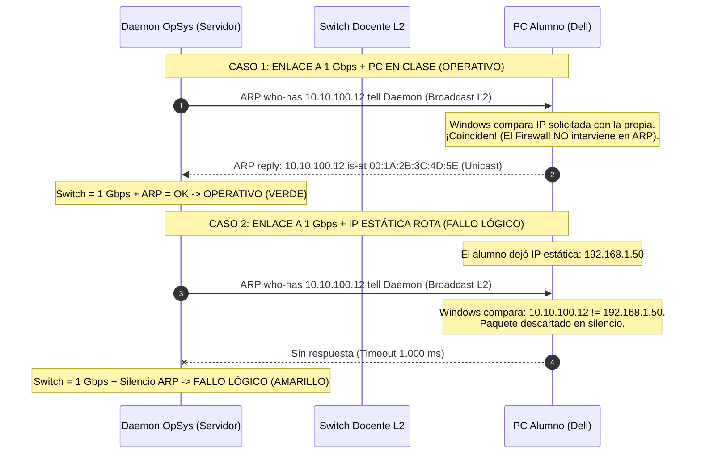
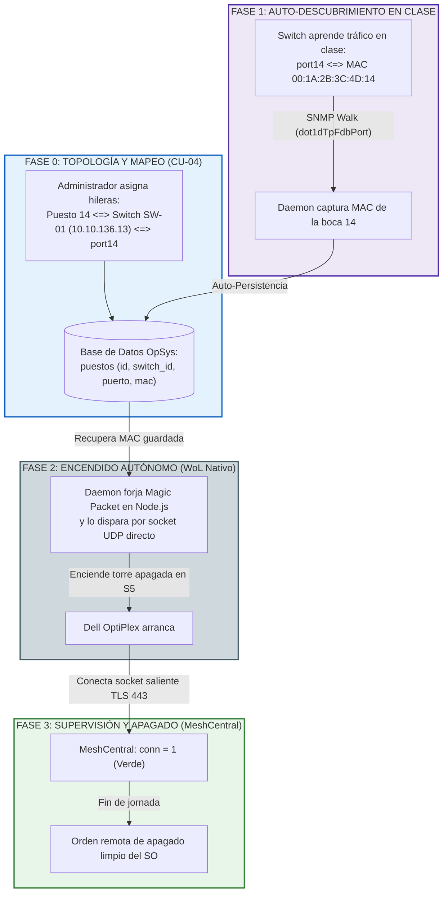

<div align=right>

|[](/README.md) [](/RUP/README.md) [](/RUP/00-modelo-del-dominio/README.md) [](/RUP/01-requisitos/README.md) [](/RUP/01-requisitos/01-detalle-casos-uso/README.md) [](/docs/matriz-documental-general.md) [](/docs/adr/README.md)
|-:

</div>

# Matriz Específica MDE-03: Evaluación y Comparativa de Mecanismos de Observabilidad de Red y Telemetría en Puestos de Trabajo

* **Proyecto:** OpSys / Mesh-Panel — Observabilidad y Supervisión de Laboratorio Docente
* **Fecha:** 2026-11-24
* **Fase:** RUP Elaboración / Arquitectura — Evaluación de Alternativas de Telemetría
* **Ámbito del Sistema:** 60 estaciones Dell OptiPlex (Windows 10/11 Enterprise/Education SKU 631-ADPL sin Intel AMT), 3 switches gestionados de rack (SNMP v2c MIB-II: `10.10.136.13`, `10.10.136.42`, `10.10.136.39`), red de docencia y switch aislado de prácticas.
* **Propósito:** Evaluar con rigor técnico, experimental y de redes las tres alternativas de observabilidad planteadas para desambiguar el estado operativo del aula frente a fallos lógicos: **Ping (ICMP) + SNMP**, **ARP Request + SNMP** y la arquitectura de referencia **MeshAgent (Capa 7) + SNMP (Capa 1)**.
* **Documentos de Referencia:**
  * [Matriz Documental General](../matriz-documental-general.md)
  * [MDE-01: Control de Energía y Realidad Hardware Dell](matriz-referencias-apagado.md)
  * [MDE-02: Plataforma Microsoft Learn y Windows Internals](matriz-referencias-plataforma-microsoft.md)
  * [Dossier Técnico DOC-01: Windows Internals, DHCP y WoL](../doc/DOC-01-microsoft-windows-internals-dhcp-wol.md)
  * [ADR-002: Acotamiento de Control de Energía](../adr/ADR-002-acotamiento-control-energia-hardware.md)
  * [ADR-003: Remediación y Exclusión del Switch](../adr/ADR-003-arquitectura-remediacion-gpo-exclusion-switch.md)
  * [ADR-004: Inclusión de Switch y Asignación Granular en Distribuciones](../adr/ADR-004-inclusion-switch-asignacion-distribuciones.md)

---

## 1. Planteamiento del Problema y Origen del Debate Técnico

En la supervisión en tiempo real de aulas y laboratorios universitarios de redes y sistemas, la infraestructura física (conmutadores gestionados) proporciona telemetría limpia de Capa 1 mediante SNMP MIB-II (`ifOperStatus`, `ifSpeed` bajo RFC 2863 [STD-01]):
* **`DOWN (2)`:** El cable está desconectado de la roseta docente o trasladado al switch de prácticas.
* **`UP (1)` a 10/100 Mbps:** Cable conectado físicamente; el PC está apagado en reposo ACPI $S5$ recibiendo tensión auxiliar de reserva (5VSB) para la escucha de *Magic Packets* Wake-on-LAN (RFC 2863, Intel AP-468 [DOC-INTEL-02]).
* **`UP (1)` a 1000 Mbps (1 Gbps):** Cable conectado y tarjeta de red negociada a máxima velocidad (el PC está físicamente encendido).

### El Dilema de la Boca a 1 Gbps
Cuando el puerto del switch negocia a **1 Gbps**, el conmutador no puede determinar el estado del software dentro del sistema operativo. Se presentan dos escenarios mutuamente excluyentes:
1. **Caso A (Operativo):** El alumno trabaja en clase ordinaria; Windows tiene IP institucional válida y salida a red docente.
2. **Caso B (Fallo Lógico):** El alumno alteró la configuración de red durante una práctica (fijó una IP estática manual ajena a la universidad en `HKLM\...\Interfaces` o DHCP no respondió y el cliente degradó a APIPA `169.254.x.x` [DOC-MS-01]). La máquina tiene enlace físico a 1 Gbps pero está completamente incomunicada.

La dirección académica del proyecto propuso prescindir de agentes en los puestos clientes (*In-Band*) y recurrir a sondeos de red tradicionales: **Ping (ICMP) + SNMP** o **ARP Request + SNMP**. Esta matriz analiza exhaustivamente la viabilidad técnica, límites de red y peajes arquitectónicos de cada alternativa.

---

## 2. Matriz Comparativa Multidimensional Consolidada

A continuación se contrastan las tres alternativas bajo criterios de red, seguridad, rendimiento y control operativo:

| Dimensión / Criterio Técnico | Alternativa 1: Ping (ICMP) + SNMP | Alternativa 2: ARP Request + SNMP | Alternativa 3: MeshAgent + SNMP *(Arquitectura OpSys)* |
| :--- | :---: | :---: | :---: |
| **Capas OSI Involucradas** | Capa 1 (Física) + Capa 3 (Red) | Capa 1 (Física) + Capa 2 (Enlace) | Capa 1 (Física) + Capa 7 (Aplicación) |
| **Detección de Standby y Cable** | ✅ Resuelto por SNMP | ✅ Resuelto por SNMP | ✅ Resuelto por SNMP |
| **Detección de Fallo Lógico (IP cambiada)** | ❌ **Inviable sin alterar firewall** (Falso positivo masivo continuo) | 🟢 **Viable** (Si no responde al ARP de su IP oficial, se deduce IP cambiada) | 🟢 **Nativa y determinista** (Falta de socket WebSocket saliente hacia el servidor) |
| **Impacto de Windows Defender Firewall** | 🛑 **Bloqueo por defecto** (`ICMPv4-In Echo` deshabilitado de fábrica en Win 10/11) | 🟢 **Inmune** (El kernel contesta ARP a nivel de NDIS antes del filtro del firewall) | 🟢 **Inmune** (Conexión saliente TCP 443 estándar hacia MeshCentral) |
| **Frontera de Red (VLANs / Routers)** | 🟢 Atraviesa routers y subredes nativamente (Capa 3 enrutable) | 🛑 **No cruza routers** (Trama broadcast L2 `FF:FF:..` descartada en frontera L3) | 🟢 Atraviesa routers, NATs y proxies sin requisitos de enlace |
| **Requisito en Switch para el Servidor** | Puerto de acceso normal en cualquier VLAN | ⚠️ **Obliga a Trunking 802.1Q** hacia el servidor para acceder a la VLAN cliente | Puerto de acceso normal en cualquier red |
| **Permisos en el Daemon / Docker** | Requiere permisos de socket crudo (`CAP_NET_RAW` / `root`) | Requiere permisos de socket crudo (`CAP_NET_RAW` / `root`) | 🟢 **Modo usuario sin privilegios** (Consultas HTTP / RAM normales) |
| **Principio *Zero-Touch* en Clientes** | ❌ **Ruptura estricta** (Obliga a desplegar GPO para abrir firewall en los 60 PCs) | 🟢 Cumplido (No altera la configuración del cliente) | 🟢 **Cumplido** (Reutiliza el agente preinstalado por la universidad) |
| **Latencia de Refresco (60 puestos)** | 🐢 **Lenta (1.500 – 3.000 ms)** esperando timeouts de hosts sin respuesta | 🐢 **Lenta (1.000 – 2.000 ms)** en ráfaga esperando timeout de Capa 2 | ⚡ **Ultrarrápida (~14 milisegundos)** directa desde snapshot en memoria RAM |
| **Tráfico Generado en la VLAN Alumnos** | Moderado (paquetes dirigidos unicast) | ⚠️ **Crítico si es periódico** (720 broadcasts/min) / Bajo si es solo bajo demanda | 🍃 **Cero** (El socket ya está establecido y en reposo) |
| **Comportamiento en Arranque (POST/BIOS)** | Timeout hasta que el kernel cargue el firewall | ⚠️ **Falso fallo lógico transitorio** (puerto a 1 Gbps antes de que Windows levante IP) | 🟢 **Determinista** (Solo reporta conectado cuando el SO y el agente están listos) |
| **Encendido Remoto (WoL)** | 🟢 Soportado (Magic Packet Ethernet Capa 2) | 🟢 Soportado (Magic Packet Ethernet Capa 2) | 🟢 Soportado (Magic Packet Ethernet Capa 2) |
| **Apagado Remoto Ordenado (Power Off)** | 🛑 **IMPOSIBLE** (ICMP es de solo diagnóstico, sin canal de control) | 🛑 **IMPOSIBLE** (ARP carece de payload para órdenes de sistema) | 🟢 **Totalmente Soportado** (Orden remota por socket al SO cliente) |
| **Punto Único de Fallo (SPoF)** | Switch docente (Capa física) | Switch docente (Capa física) | Servidor MeshCentral (mitigado por telemetría SNMP en switch) |

---

## 3. Análisis Técnico Detallado por Alternativa

### 3.1. Alternativa 1: Ping (ICMP Echo Request) + SNMP — La Falsa Simplicidad

El protocolo ICMP (RFC 792) opera en la Capa de Red (Capa 3). Su concepción teórica sugiere que emitir un paquete `ping 10.10.100.X` a la IP institucional del puesto confirmaría si el sistema operativo está enrutando paquetes:

```
[Daemon OpSys] ──(ICMP Echo Request)──> [Switch / Router] ──> [PC Alumno (Dell)]
                                                                      │
                                                                      ▼
                                                         [Windows Defender Firewall]
                                                         ¿Regla ICMPv4-In habilitada?
                                                                      │
                                                                      ▼
                                                         ❌ NO (Desactivada de fábrica)
                                                                      │
                                                                      ▼
                                                            [DESCARTE EN SILENCIO]
                                                            (Request Timed Out)
```

#### Causas de Inviabilidad Técnica:
1. **El Muro de Windows Defender Firewall:**  
   En Windows 10 y Windows 11 Enterprise/Education (estándar de la imagen Dell del laboratorio), la regla de entrada `Archivos e impresoras compartidos (Petición de eco: ICMPv4 de entrada)` está **deshabilitada de forma predeterminada** en los perfiles *Público* y *Privado*. El kernel de Windows descarta en silencio el paquete sin emitir `ICMP Echo Reply`.
2. **El Colapso del Diagnóstico (Falso Positivo Universal):**  
   Dado que un PC perfectamente operativo en clase descarta el ping por política de firewall, y un PC con fallo lógico de IP también da timeout, **el panel es incapaz de distinguirlos**. Toda el aula aparecería permanentemente pintada de amarillo (`FALLO_LOGICO`).
3. **Violación del Principio *Zero-Touch*:**  
   Para habilitar la respuesta al ping, la institución se vería forzada a desplegar directivas de grupo (GPO) para abrir puertos en el firewall de los 60 puestos, vulnerando la directriz fundamental del TFG de no realizar modificaciones intrusivas en los clientes.
4. **Asimetría Operativa Total:**  
   El ping no transporta carga útil de comando. Resulta técnicamente imposible inducir el apagado remoto del equipo mediante tráfico ICMP.

---

### 3.2. Alternativa 2: ARP Request + SNMP — La Astucia de Capa 2 con Peajes de Infraestructura

El protocolo de resolución de direcciones ARP (RFC 826) opera en la Capa de Enlace (Capa 2), traduciendo direcciones IPv4 a direcciones físicas MAC. 



#### Fundamento del Diagnóstico:
La deducción planteada por la dirección del TFG es formalmente válida:
* Si el switch confirma por Capa 1 que el puerto está `UP a 1 Gbps` (descartando que esté apagado en standby o desconectado).
* Y el equipo no responde a la petición ARP de su IP institucional oficial (`10.10.100.X`).
* Como el Firewall de Windows no interviene en el filtrado de tramas ARP a nivel de controlador NDIS, la ausencia de respuesta demuestra de forma unívoca que **la máquina tiene una IP distinta o desconfigurada** $\implies$ **`FALLO_LOGICO` (Amarillo)**.

#### Peajes Críticos y Limitaciones Insalvables:
1. **La Frontera de Enrutamiento y Obligatoriedad de Trunking (802.1Q):**  
   Las tramas ARP son de difusión (`FF:FF:FF:FF:FF:FF`) y **los routers jamás las reenvían entre VLANs** (RFC 1812). Si el servidor del panel reside en una subred de gestión (`10.10.136.x`) y los puestos en la VLAN de alumnos, el servidor no puede emitir ARP directo. Para habilitarlo, es obligatorio configurar un puerto troncal (*VLAN Trunk 802.1Q*) en el switch hacia el servidor y levantar subinterfaces virtuales etiquetadas (`eth0.100`) con permisos `CAP_NET_RAW` en Linux/Docker.
2. **Inundación de la Red (*Broadcast Storm*) vs. Mitigación Bajo Demanda:**  
   Un escaneo ARP continuo a 60 puestos cada 5 segundos inyecta **720 paquetes de difusión por minuto** en la VLAN de alumnos, forzando a todas las tarjetas de red a interrumpir sus procesadores. Aunque este problema se mitiga implementando el escaneo **estrictamente bajo demanda** (al abrir el modal de inspección o al detectar un cambio de estado en el switch), la apertura inicial del panel exigiría esperar ráfagas con latencias de 1,5 a 2 segundos.
3. **Imposibilidad de Consulta Inversa:**  
   No es posible consultar al puesto su IP a partir de su MAC porque el protocolo **RARP (RFC 903) fue declarado obsoleto** hace más de 30 años y no está soportado por las pilas de red modernas.
4. **El Muro del Control Energético:**  
   El protocolo ARP es estrictamente de resolución de direcciones; carece de carga útil o comandos de control. **Hacer observabilidad con ARP condena al panel a ser una herramienta de solo lectura**, perdiendo para siempre la capacidad de apagar los puestos al terminar la jornada.

---

### 3.3. Alternativa 3: MeshAgent (Capa 7) + SNMP (Capa 1) — Arquitectura de Referencia OpSys

La arquitectura implementada en OpSys desacopla y correlaciona dos fuentes de datos independientes y complementarias:

```
┌─────────────────────────────────────────┐         ┌─────────────────────────────────────────┐
│        CAPA 1: FÍSICA / ENLACE          │         │         CAPA 7: LÓGICA / S.O.           │
│   Switches Gestionados del Aula         │         │        Servidor MeshCentral             │
│   (SNMP v2c MIB-II: ifOper / ifSpeed)   │         │       (MeshAgent WebSocket TLS 443)     │
└────────────────────┬────────────────────┘         └────────────────────┬────────────────────┘
                     │                                                   │
                     └─────────────────────────┬─────────────────────────┘
                                               ▼
                                ┌─────────────────────────────┐
                                │       PANEL OPSYS           │
                                │   Motor de Correlación RAM  │
                                │  (Latencia: ~14 ms por SSE) │
                                └──────────────┬──────────────┘
                                               │
                        ┌──────────────────────┴──────────────────────┐
                        ▼                                             ▼
             ⚡ CONTROL DE ENCENDIDO                       🛑 CONTROL DE APAGADO
           (Magic Packet WoL Capa 2)                   (Orden remota Capa 7 vía Agente)
```

#### Ventajas Arquitectónicas Fundamentales:
1. **Conexión Saliente Asíncrona (*Outbound WebSockets*):**  
   MeshAgent corre como servicio de fondo y establece un socket TCP saliente cifrado sobre TLS hacia el puerto 443 de MeshCentral. Atraviesa cortafuegos, NATs y enrutadores de campus sin requerir puertos abiertos en los clientes ni trunking en el conmutador.
2. **Latencia Inexistente (< 15 ms en Memoria RAM):**  
   El estado del agente no se sondea activamente por la red en cada petición; reside de forma persistente en la memoria del servidor. La correlación determinista de 60 puestos se ejecuta en tiempo $O(1)$ (< 0.2 ms), reduciendo los tiempos de respuesta de la API a ~14 ms.
3. **Simetría Operativa Completa:**  
   Aprovecha lo mejor de cada capa: Capa 2 para encendido determinista por hardware desde $S5$ (WoL [MDG-01]) y Capa 7 para apagado limpio y ordenado de Windows al finalizar las sesiones docentes.
4. **Reutilización de Infraestructura Preexistente (*Zero-Touch* Real):**  
   La universidad ya dispone de MeshAgent preinstalado en la imagen corporativa del parque Dell OptiPlex. OpSys no introduce software adicional en los puestos clientes.

---

## 4. Análisis Crítico y Evaluación de los Contras del Enfoque con Agente

En cumplimiento del rigor metodológico de RUP, se documentan con total transparencia las servidumbres técnicas e inconvenientes de depender de un agente en el sistema operativo:

### 4.1. Punto Único de Fallo (*Single Point of Failure - SPoF*)
* **Riesgo:** Si el servidor de MeshCentral sufre una caída de servicio o corrupción en su base de datos, los 60 agentes pierden su WebSocket simultáneamente. El panel observaría a todos los puestos encendidos en falso `FALLO_LOGICO`.
* **Mitigación en OpSys:** La telemetría SNMP en el switch docente actúa como desacoplador físico: el panel reconoce que la portadora de Capa 1 y la velocidad de 1 Gbps permanecen intactas, permitiendo al sistema distinguir entre una avería de la estación cliente y la indisponibilidad del servidor de gestión.

### 4.2. Superficie de Ataque y Privilegios en el Host
* **Riesgo:** `meshagent.exe` requiere ejecución bajo contexto `NT AUTHORITY\SYSTEM` en Windows para poder invocar llamadas al sistema como `InitiateSystemShutdownEx()`. Si la plataforma MeshCentral se viese comprometida, el atacante obtendría privilegios elevados en las máquinas.
* **Mitigación:** En entornos corporativos, MeshCentral debe operar bajo autenticación multifactor (MFA), canales TLS 1.3 con certificados institucionales y aislamiento de red en VLAN de gestión.

### 4.3. Desfase Temporal en Transiciones (*Time Skew*)
* **Riesgo:** La caída física de un cable es detectada por el hardware del switch en microsegundos, mientras que la desconexión del WebSocket en MeshCentral puede demorarse entre 5 y 15 segundos hasta el agotamiento de los temporizadores de *Keep-Alive* TCP.
* **Mitigación:** La máquina de estados de OpSys da precedencia inmediata al estado de Capa 1: si `ifOperStatus == DOWN`, el puesto transiciona a `DESCONECTADO` de forma instantánea sin esperar la expiración del socket de Capa 7.

### 4.4. La Limitación del Apagado ante el Propio Fallo Lógico (*Fate Sharing*)
* **Riesgo:** Si un alumno desconfigura la IP, el agente pierde conectividad con MeshCentral. Al no haber canal de Capa 7 funcional, **el panel tampoco puede ordenar el apagado remoto a esa máquina averiada** ([ADR-002](../adr/ADR-002-acotamiento-control-energia-hardware.md)).
* **Realidad de Ingeniería:** El sistema garantiza el apagado remoto del 100% de las máquinas sanas. Para las máquinas con fallo lógico, OpSys cumple con precisión la función diagnóstica, alertando al operador para que proceda a la desconexión manual en la torre.

---

## 5. El Puente de Identidad Universal: Auto-Descubrimiento de MACs por SNMP y Persistencia en BDD

Para resolver el desacoplamiento entre las bocas físicas del switch y los puestos sin depender de listados manuales ni de servidores externos para encender, OpSys formaliza una arquitectura de **Auto-descubrimiento y Persistencia Híbrida**:



1. **Auto-descubrimiento por SNMP Bridge MIB (`dot1dTpFdbPort`):** Durante las sesiones ordinarias con los puestos encendidos, el switch registra la MAC de cada equipo en su tabla FDB. El daemon ejecuta un barrido SNMP pasivo, asocia la MAC detectada con la boca correspondiente y la almacena automáticamente en la base de datos de puestos (`puestos.mac`), eliminando la necesidad de importar hojas de cálculo manuales de soporte.
2. **Encendido Autónomo por Wake-on-LAN Nativo (UDP):** Al llegar a primera hora de la mañana con el aula apagada en reposo $S5$ (habiendo expirado la tabla FDB del switch), el daemon recupera la MAC persistida en su propia base de datos y genera el *Magic Packet* directamente mediante sockets UDP nativos (`dgram` en Node.js). Esto desacopla el encendido de MeshCentral, permitiendo encender el aula completa incluso ante una caída total del servidor de gestión.
3. **Reserva de MeshCentral para Capa 7:** MeshCentral se acota a su función insustituible: monitorizar la salud lógica del sistema operativo (`conn=1` vs `conn=0` ante fallos de DHCP) y emitir la orden de apagado ordenado al término de la clase.

---

## 6. Resolución Metodológica: Caso de Uso `CU-04: asignarPuestosASwitch`

La necesidad de mantener la correlación física entre las mesas del aula y los 3 switches gestionados del rack (`SW-01: 10.10.136.13`, `SW-02: 10.10.136.42`, `SW-03: 10.10.136.39`) motivó la especificación formal y desarrollo del caso de uso **`CU-04: asignarPuestosASwitch`**:

### 6.1. Desambiguación de Telemetría Masiva (Bulk Polling) y Colisión de Bocas Homónimas
Para optimizar el rendimiento y no saturar la CPU de los conmutadores, el daemon no realiza consultas puerto a puerto, sino que lanza **consultas masivas en paralelo (*Bulk SNMP*)** a los 3 conmutadores mediante `Promise.all`:
1. **La Coexistencia en RAM:** Los tres switches disponen de interfaces con la misma numeración (`port1`, `port2`, ..., `port14`, etc.). En cada ciclo de refresco conviven en memoria tres estados para la misma boca (ej. `port14` en `.13` a 100 Mbps, en `.42` en DOWN, y en `.39` en DOWN).
2. **El Filtro Discriminador:** `CU-04` establece a qué conmutador pertenece cada mesa física. Al evaluar el `Puesto 14`, el sistema consulta su asignación (`10.10.136.13`), extrae exclusivamente la telemetría de esa IP y descarta las bocas homónimas de los otros dos switches, evitando clasificar el puesto erróneamente en falso estado desconectado.

### 6.2. Ancla de Identidad y Encendido Determinista (WoL en Standby S5)
Cuando los puestos están apagados, la tabla FDB del switch purga automáticamente las direcciones MAC tras 5 minutos de inactividad (*Aging Timeout*). Al carecer de MAC viva en el switch y tener `conn = 0` en MeshCentral:
* La asignación persistente de `Puesto` garantiza que el sistema recuerda de forma inmutable qué torre Dell (con su MAC física) está alojada en cada mesa y conectada a cada boca.
* A primera hora de la mañana, con toda el aula en reposo $S5$, el panel detecta la portadora de standby a 10/100 Mbps y **arma el botón `[⚡ WoL]` con la MAC exacta del puesto**, haciendo posible encender los 60 ordenadores con un solo clic.

### 6.3. Resiliencia ante Cambios en el Armario de Conmutación
Si los técnicos de soporte trasladan una hilera de puestos a otro switch o cambian puertos en el patch panel, el operador puede reconfigurar el mapeo en caliente mediante interfaz visual sin reiniciar el daemon ni modificar código fuente, cumpliendo el principio de mapeo transitivo de [ADR-004](../adr/ADR-004-inclusion-switch-asignacion-distribuciones.md).

---

## 7. Dictamen Técnico Final y Conclusiones de Ingeniería

1. **Descarte Formal de Ping + SNMP:** Se rechaza de forma definitiva debido a que el bloqueo por defecto de ICMP en Windows Defender Firewall produce una tasa del 100% de falsos positivos en puestos operativos, exigiendo vulnerar el principio *Zero-Touch* mediante GPOs invasivas.
2. **Acotamiento de ARP + SNMP como Alternativa de Solo Lectura:** Se valida que la combinación de `ifOperStatus = 1 (1 Gbps)` con sondeos ARP selectivos bajo demanda resuelve matemáticamente la detección del fallo lógico sin interferencia del cortafuegos. No obstante, se desaconseja como solución integral debido a que exige enlaces troncales 802.1Q en el servidor, permisos `CAP_NET_RAW` en contenedores y **elimina completamente la capacidad de emitir apagados remotos**.
3. **Consolidación de MeshAgent + SNMP:** Se ratifica como la arquitectura óptima para el proyecto OpSys. Proporciona una solución robusta, no invasiva y de altísimo rendimiento (< 15 ms), ofreciendo simetría operativa total (encendido por hardware en Capa 2 y apagado por software en Capa 7) reutilizando la infraestructura preexistente de la universidad.
